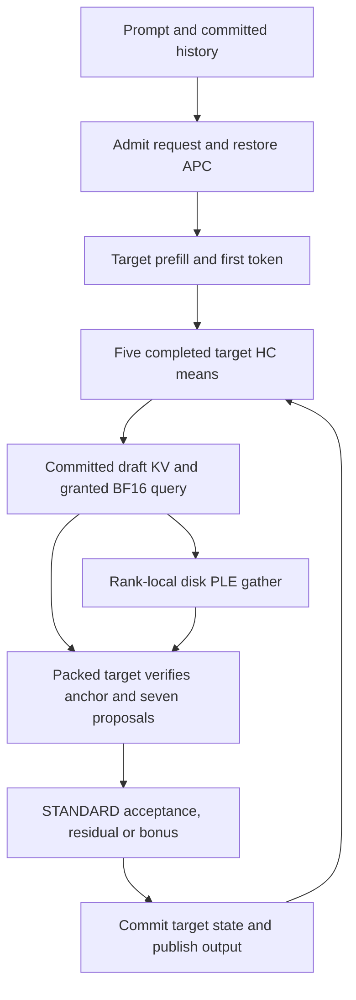

# Qwen3.8 Flash-Next: a practical SGLang DFlash2 tuning guide

This guide follows the four-B70 SGLang implementation from the first real checkpoint load to the accepted image and its live engine qualification **PASS**. The performance reference is accepted vLLM 0.33 DFlash2 **expanded2-exact-v6**. The implementation had to support ordinary sampled serving with the original checkpoints, exact STANDARD verification, native context and four live requests. The fastest experimental image at a given milestone could lose on completed answers, recurrent state, or physical memory.

Results are organized by optimization area. C1–C4 denote occupied request widths or client concurrency as specified, K7 denotes seven proposals, and TTFT measures the first content-bearing update, including reasoning. Diagnostic intervals and clean serving results retain their original conditions. The v6 tuning guide provides the twelve-section format. The published v6 production archive documents the engineering lineage for transferred mechanisms. [v6 release][v6-release]

## 1. Runtime, model and correctness boundaries

### Qualification platform

| Component | Selected configuration |
| --- | --- |
| B70 host | Four Intel Arc Pro B70 GPUs, 32,656 MiB reported per card, AMD EPYC 7443, 256 GiB installed host RAM and NVMe storage |
| Runtime | Ubuntu 24.04.5 XPU ABI from the immutable v6 base, Linux `xe`, Level Zero, Torch 2.14.0+xpu, SGLang `ecd3d75a2a790cdb3acba0ecdb4786ff4d4ab25d` plus runtime overlays, sglang-kernel-xpu 0.6.0 `555588379c04d213388efaa043828560718a70f4`, and SYCL-TLA `7b56b936b87f799f80dde60c2fd8d11c1128cebb` |
| Target | `Intel/Qwen3.8-Flash-Next-W4A16-AutoRound@4c67bf686b7f7fd386bae6b07ab59e8ff1d5b897`, dense text attention, BF16 activations/KV/PLE, signed INT4 AutoRound group-128 routed experts, FP32 GDN state and BF16 convolution history |
| Draft | `incoai/Qwen3.8-Flash-Next-DFlash2@a22a1744e85c17364dcc54a6a420af7135d4c7f6`, trained BF16, TP4, original calibration and target embedding/head |
| Serving | TP4/EP4, four running slots, 276,480 target KV rows on a shared 128-token page grid, APC with recurrent checkpoints, 262,144 input-plus-output context |
| Speculation | Eight query and verification positions including the anchor, support 16, actual conditional q, STANDARD and the initial-thinking EOS guard |

The target has 48 layers, 36 Gated DeltaNet (GDN) and 12 full attention, hidden width 2,560, four hyperconnection (HC) streams and HC low rank 320. Its 512 logical routed experts use top-10 routing and 640 intermediate channels. Full attention has 24 query heads, two KV heads and dimension 256. The TP4 kernel sees six query heads and one local KV head. The vocabulary storage has 248,320 rows. The dense adapter removes five indexer configuration keys, excludes 128 PLE entries from ordinary loading and preserves the AutoRound exclusion list. The original frontend files and tensors are read-only.

The parity requirements included the no-FP8 constraint. The reference used v6's immutable OCI index `sha256:2fa91d1ac8c17ad866d9ae7eaea83ac1b1666ffd0ccceb7685564f55528c47af` and Controller pack 1.0.6. Its production and frozen qualification launch used the same engine settings after diagnostic flags and mounts were removed. The first SGLang source inspection established which features were available to test. The first B70 foundation was measured on the source-built runtime.

| Investigation | Conditions and measurements | Outcome |
| --- | --- | --- |
| Source-built four-card foundation | Disabled unused Rust extensions, used a clean export and offline pinned SYCL-TLA, restricted the Xe2 AOT dispatcher to compiled BF16 variants after link failures. Real text returned `4` at EOS and repeated six greedy IDs. All four ranks passed BF16 attention, cyclic INT4, GDN, PLE and BF16/int64 collectives in component tests | Short eager bring-up at 256 prompt rows, 1,024 context and C1. Initial integrated direct SYCL recurrence remained blocked. |
| Frontend and same-seed replay | Qwen3 parser split 37 reasoning tokens from the correct final with identical generated IDs. The original sampler ignored seeds. Global deterministic inference moved the attention reduction and changed greedy outputs. The scoped PyTorch-seeded XPU route repeated seed 7041 and changed seed 7042, but the 768-token backup still diverged at token 104 | Kept the scoped sampler and parser. The partial global-deterministic attempt and failing CPU MurmurHash probe remain historical. |
| Matched v6 behavior and unsupported rollback claim | All 18 fixed prompt-ID arrays matched. The corrected matched cohort scored 7/15 cases on both engines. The SGLang rerun fell to 6/15 versus v6's 7/15. The expanded run scored 38/39 expanded cases on both and found unsupported rollback outcomes in 21/31 SGLang versus 18/31 v6 seeded replies, Fisher p=0.60. At 68 teacher-forced prefixes top-1 agreed 65 times | The fixed rubric remains failed. The sample and cross-scores support a shared model behavior for this claim. The seed streams differ by engine and the cohort cannot resolve smaller rate differences. |
| Worker-local deterministic oneDNN | Replayed saved 216-token operands. At layer 5 the GDN, projections and first collective repeated. The HC injection gate moved on identical inputs and Torch alone reproduced the unstable BF16 GEMM. The deterministic primitive attribute stabilized all 48 layers on four ranks and the 768-token replay, which still capped in reasoning. Bounded 124-token check measured 1.430 vs 1.383 s prefill and 4.723 vs 4.781 tok/s decode | The foundation was accepted with worker-local deterministic oneDNN as the default. Determinism at a given width leaves shape-dependent rounding. Global deterministic mode stayed off. |

### DFlash2 and native MTP require different optimizations

DFlash2 uses a separate five-layer BF16 model. Its 2,560-wide draft has 32 Q and eight KV heads of dimension 128, a trained 2,048-token noncausal window, a two-tap grouped convolution and a rank-256 selector. It shares the target embedding and vocabulary head. The target provides the four-stream HC mean at each completed layer 5, 15, 25, 35 and 45 (zero-based), after the corresponding delayed HC write-back. The five means concatenate to 12,800 BF16 features per committed token. Graph or allocator reuse must preserve these feature values until the draft consumes them. Draft integration verified the checkpoint's 81 BF16 tensors and matched the v6 calibration. Native MTP feeds back hidden state through an in-model prediction layer and has different depth, head and state costs. MTP5's measurements do not establish DFlash2 speed or quality.



### What must remain consistent

For target probability `p` after temperature, filters, request penalties and EOS policy, and the actual proposal probability `q` conditional on the realized predecessor, a proposed token `x` is accepted with probability `min(1,p(x)/q(x))`. The first rejection samples from normalized positive residual `[p−q]+` over the target vocabulary. If all seven pass, the last target row supplies the bonus. Unchosen draft support entries retain their correct conditional masses and tokens outside support have zero draft mass. The reasoning guard deliberately restricts EOS during initial open reasoning. The minimum-length guard has its own token-history semantics. The acceptance law applies to the represented target distribution produced by the active arithmetic, including its width and reduction order.

At commitment, BF16 target KV and convolution, FP32 recurrent state, PLE histories and BF16 draft context all have to describe the same prefix. Candidate suffix writes are provisional, including the final page at the native boundary. The request table reserves scratch positions separately from the 262,144-token public budget. Request ID, slot generation, owned page extent, resident mappings and execution order participate in eligibility. A rank disagreement on a collective-bearing route can strand peers. Same-width repetition, a same-state eager oracle, cross-width comparison and a completed-task check answer distinct questions.

## 2. GDN metadata, recurrence and address safety

### Remove repeated preparation without sharing distinct state

GDN owns a working FP32 state matrix and BF16 convolution history per active request and layer. APC tracks selected intermediate positions, including those inside a prefill chunk. Packed verification needs independent temporal columns and a way to materialize the accepted offset. The optimizer can share index planning, stage pointers once and copy a live seed directly, as long as the original owner's destinations and offsets survive reuse.

| Investigation | Conditions and measurements | Outcome |
| --- | --- | --- |
| Direct native recurrence bring-up | The initial standalone SYCL oracle passed with max BF16 output error 3.052e-5 and FP32 state error 5.714e-5. In the real process layer 0 left 7/8 lanes unwritten. Loading the v6 extension after SGLang reproduced the collision between identically named 32- and 256-thread functors | Renamed the functor and packed gate views for the native ABI. The revised operator passed 144 real prefills and 144 decodes, but the integrated opt-in initially failed greedy smoke and scored 6/15. Explicit FP32 XPU recurrence stayed the baseline. Later native kernels qualified different contracts. |
| Initial eager multi-chunk path | Deterministic 256-token chunks repeated IDs/top-20 through 8,193 tokens, seven long turns reached correct finals, including the 8,182-token handover. Wider 1,024-row diagnostic changed the fourth greedy ID at 257/511/1,024/1,025, with common-history teacher-forced drift up to 2.854468 nats | Retained 256 for the standing eager baseline. Future-token mutation at fixed width preserved earlier logits. A projection replay reproduced the first difference in layer-0 `in_proj_qkvz` using Torch alone, with identical inputs and byte-verified rank weights. 398 of 409 changed values were adjacent BF16 words near midpoints. Later widths need their own numerical gates. |
| Whole ordered recurrence | Original eager work submitted FP32 operations per token in all 36 layers. Ordered SYCL completes a slot range per launch and writes the interior checkpoint. The row-parallel version distributes independent rows across 16-lane workgroups using 256 GRFs | Became the controlled prefill path after full native and state tests. Cold 8,193-token TTFT on isolated direct requests moved 81.890→7.889→6.109 s across the initial OCI build, the first ordered recurrence and the row-parallel version with several simultaneous execution changes. |
| Wide GDN and ordered prepare | Above 128 rows the wide path uses donor Xe2 convolution, normalization, layout and ordered 64-token DPAS recurrence, preserves the original short trajectory and checks mixed seeded/fresh/zero-length state. Across four ranks its 256-row diagnostic moved 37.5–56.7→12.3–25.5 ms in the GDN region. The native packed verifier transfers the int64 speculative route. Shared preparation reuses eager GDN plans and copies live FP32 seeds. The checkpoint export and aligned-tail builds qualify native checkpoint export through wide work and short aligned tails | Retained by shape with exact state controls. Readback, packing and grouped snapshots are included according to each record's boundaries. |
| Factored recurrent rollback | Save ordered FP32 update operands in the existing temporal storage, then materialize the accepted and tracked states. Parallel preparation preserves BF16 gate addition, normalization and chronological update order | Selected after real-operand and live commit comparisons. The execution-only build preserves it while regrouping prefill checkpoint export. Final qualification checks all eight offsets, 20 tracking destinations and 685,080,760 state elements. |

### Address arithmetic and layout are independent safety requirements

The int64 donor widens the state ID before multiplying by stride. The v6 research's original signed-32-bit convolution crossing was at state 5,042 with stride 425,984. High addresses, zero rows, page crossings and correct inner layout require separate tests. SGLang's first four-row K7 verify exposed a different error. XPU convolution returned channel-major strides and the caller flattened with `view`. Using `reshape` packed those rows while leaving the serial layout intact. The packed verifier also repaired short attention page staging that reached beyond the decode horizon at 4,088 tokens. Short/split boundary requests at 4,088/4,093/4,097 exercised the guarded staging and per-position fallback. Native prompt admission maintains reserved table/KV positions, and the draft and target RoPE caches covered speculative scratch through position 262,150 in the draft-integration and graph probes.

### Recurrence and precision experiments

| Mechanism | What happened | Decision |
| --- | --- | --- |
| Explicit FP32 plus Triton pointwise fusion | Serial 256-token chunks completed a 262,048-token retrieval in 2,899.138 s. The opt-in preserved original FP32 dot reductions, fused the scalar update, matched sampled BF16 outputs and FP32 states, and reduced isolated GDN time 16.35–17.21%. A 262,128+16 near-limit run took 2,295.481 s with different token counts | Successful diagnostic. Fusion was parked during four-slot/APC bring-up. Later ordered kernels and native checkpoint export qualified separately. |
| Packed short GDN and donor-aligned arithmetic | Donor component checks passed. Against the prior split-target build at 107 rows, subsequent probe found 92,554/164,352 BF16 output words and every checked FP32 working-state element changed, despite exact BF16 convolution history. The combined image lost two extended backup finals and an executable edge | Reverted short GDN, short HC and PLE/router arithmetic in the selected execution-only image. Causality for any individual generated token remains unproven. |
| Ordered recurrence with inter-token overlap | Original FP32 dot sequences and exact state retained. At 127 rows the alternate took 1.905 ms versus 0.503 ms on the prior split-target build | Excluded despite exactness. |
| Shared staging and whole short layer | The shared preparation graph captures shared row-local operand preparation. The whole-layer graph captures large QKVZ, original four-tap conv, ordered recurrence, gated norm and output projection. A core-only graph added 20/14/16 µs at 64/95/128 rows. Every one of 144 admissions failed at 95 rows padded to 128. A 96-row class fixed the output projection, and true-width B/A fixed remaining single-word gate differences | Whole layer selected for eligible pure short extensions with cold or restored state. Uses private work state and preserves true TP width. Tracking, scoring, mixed and vision follow their ordinary paths. The final cold/restored comparison matched 12,493,651,968 words on four ranks over widths 16–127, plus ordinary 128-row tracking. |

## 3. Graphs, ownership and communication

### Capture the region that removes real overhead

| Investigation | Conditions and measurements | Outcome |
| --- | --- | --- |
| First graph boundaries | Real XPU replay for per-row FP32 target recurrence and C1–C4 five-layer draft query. Query embeddings, positions and page rails are staged. Same-state tests at C4 matched 7,946,240 logits and 409,600 trained-feature values per window on every rank. Independent launches differed at three C4 suffixes with different admission/order | Bounded functional pass. Target KV, PLE, HC, experts, proposal sampling and commit still largely eager. Separate eager-vs-replay checks from independent scheduling. |
| Full model, eight serial replays | Whole target decode graph with live state, lengths and pages, eight executions per verification window, short and split plans at C1–C4. 18 same-state windows/rank matched 83,435,520 logits and 4,300,800 feature words. A redundant device scalar in the eligibility check stalled the first long qualification | Removed the scalar and qualified replay. Capture saved submission work, but repeated the target and PLE at each position. The first OCI build packaged this initial design. |
| Decision-driven serial verifier | Prepare the whole chain's PLE on the host, retain compact support and stop target work once every lane rejects. The deployment control took 7/3/3/3/5 forwards in its five rounds and reproduced the 17 wire IDs | Selected intermediate path. Full-window adjustments and ambiguous sorting fell back. Packed experiments still failed same-state checks at this point. |
| Return to packed K7 | Isolated one changed gated GDN normalization word at a saved 127-token prefix. Canonical TP quarters alone left the mismatch. Keeping ordinary time-column shapes for GDN/HC norms, routing and relevant dense paths recovered full scores. An initial C4 packed pass matched logits/features but changed six PLE convolution snapshot words | Kept PLE projection, gate and updates in ordinary column shapes. One graph over all eight rows per lane then matched independent serial output, candidate KV and state at all supported widths. Replaced the decision-driven serial schedule for eligible windows. |
| Packed dense attention | One launch per dense layer over independent causal Q1 rows. Each retains its own extent, page table and position. The tested long-plan split schedule is 32/16/21/8 at C1/C2/C3/C4, with one split on the short plan. All 64 changed-input packed admissions passed. Batching GDN normalization naively changed the 128-lane sum-of-squares tree and failed state admission | Kept the exact batched dense calls and shape-sensitive GDN operations at canonical geometry. The admission compares logits, trained features and selected state independently. |
| Input and query capture | The native packed build compiles owned graph staging and uses native packed kernels. Head-inclusive replay captures the draft through original head, selector and realized q, with 48 checks on four ranks. Replay with shared preparation stages original QKVZ/BA and live state without redundant repacks. The mixed-K7 build ports the noncausal BF16 paged short draft with a separate longer-history graph | Selected on guarded dispatch. Replay with shared preparation matched the preceding row-accounting build's 1,024 seeded IDs and counters with 4.4/7.2/9.5% median whole-wave gains. Same-position device diagnostics compare head-inclusive SGLang replay with v6's separate head. |
| Graph split and capture-bound output | Capture writes logits and feature means into owned rails. The checkpoint-export build stabilizes first-use page-table stride and stop-control variants. The split-target build divides the target graph around the first disk-PLE consumer so the host gather can overlap early layers. The execution-only build keeps the split and checks actual bindings and rank votes before replay | Selected. Disk I/O, request admission and final publication stay with their owners. The first C4 distributed-head candidate left its head predicate false. Only the corrected capture measured the active path. |

### Why pointer lifetime and rank agreement mattered

The first target capture mixed inference-mode scopes and left a generator in capture state after failure. Draft warmup also overwrote its embedding through a residual-add RMSNorm alias. Using one inference-mode contract and refreshing the graph-owned embedding fixed the exact replay comparison. A four-rank XCCL probe with Docker networking disabled failed communicator initialization (code 11). The isolated bridge retry changed the replay sum from 10 to 28 as expected on all cards. The execution-only build reproduced the capture-order error independently with inference-mode decode followed by no-grad capture, then put both captures and replay under inference mode while keeping the activation rails in persistent storage.

The first prefill expert graph borrowed a routing-bound scalar from scheduler state. It passed capture, then changed executed routes at new input. On the same vision input restoring the bound to 256 recovered `Green`. The corrected graph owns the device scalar and stages the current bound. The shared padded graph passed a shape and later crashed trying to reuse a pool after the last owning graph reference dropped. The repair retains a graph owner across exact-width uses and tests padding separately. The whole-FFN graph bank similarly retained its row-number vector for the graph bank's lifetime after a first FFN build lost that temporary. These failures motivate changed-input checks, stable storage, pointer/weight/stream binding guards and fallback for failed classes.

Scheduler-owned lookahead moves the ownership contract to an explicit scheduler grant. After previous result handling and ingress, the scheduler grants the ordered requests, iteration, row generations, prefix and reserved extents. Device metadata built ahead belongs to the preceding grant and can be consumed only in its immediate successor with the same owners and extent. A packed route vote includes the ownership digest and the replay route. Rank disagreement on ownership fails before collective launch. Route disagreement can take a coordinated fallback after outstanding staging drains. In the scheduler-grant diagnostic all ranks agreed on 88 grants, used 70 prepared drafts and discarded 14. A canceled slot moved from generation 17 to 18. The shared-memory route vote was checked for different grants/routes, delayed peers and tag wrap.

A host scheduling change overlaps the next TP-wide request receive and CPU broadcast with the current device work. The scheduler applies those messages at its next normal dispatch point. A separate startup change launches scheduler processes concurrently. A 195,450-byte spawn payload exceeded the 64 KiB pipe and waited for each child to import the scheduler before draining it. A writer thread sends the same payload without serializing the starts. Time to readiness moved from 127–130 s to 88–95 s. Seeded C1 improved 163.16–164.10→166.12–166.51 tok/s with identical IDs, and all deterministic standing turns repeated.

### Collective choices changed arithmetic as well as latency

| Investigation | Conditions and measurements | Outcome |
| --- | --- | --- |
| Canonical BF16 rank quarters | v6's four-part layout preserves each BF16 addition order. The checkpoint-export build feeds that representation into HC directly. The four 640-column panel control matched 8/16/24/32-row projection outputs and measured 1.12–1.16× component speed ratios | Use compatible layouts with the corresponding kernel and runtime eligibility. A separate 4/8/16-panel GDN input projection reassembly lost time. |
| C1 gather and fused HC consumer | Gather four rank partials, then sum in the original BF16 order per quarter inside HC injection. Integrated all-rank check covered all 96 boundaries. The complete C1 collective/HC component took 39.4–40.7 versus 44.7–45.8 µs. At C4 it lost | Selected at C1. A follow-up trace audit identified the earlier trace's 95 all-reduces as **eager admission**, separately from the 96 all-gathers in actual C1 replay. Higher widths use their normal reductions. |
| Wide HC shard and reduce-scatter | The initial padded row-wise reduce-scatter changed cancellation words. Selected full all-reduce and local slice. The unpadded variant reduces the original unpadded quarters and recovers a small crossing fragment, padding only the local output. Across widths 512–819 this still changed words, while 820–4,097 matched all 20,630,945,280 BF16 words in the control corpus | Selected from 820 rows using the tested message-size crossover, with original all-reduce below it. At 4,097 rows the median of rank medians was 754 versus 1,313 µs. Explicit all-to-all/rounded sums were slower in the small regime and used the wrong large-message order. |
| Four-rank vocabulary ownership | The C4 request-owner exchanges complete vocabulary rows and matches 15,892,480 probabilities on its first two active sampled checks. The positional variant partitions the eight positions among ranks. The full vocabulary for each owned position arrives in one equal-size all-to-all. Local filter/softmax and segment terminal sampling use original draws, followed by a small result gather | Positional STANDARD is active in the selected image, including the live qualification width-four wave. Each rank takes the first rejection or bonus in its own segment. The global earliest terminal wins, and later counterfactual draws publish no state. |
| Lower-latency peer transport | Threshold sweeps retained the same PCIe ring and gave no gain. Single-process raw pulls produced correct words at 8 rows only. Raw allocator-handle import failed. An independent four-process explicit Level Zero IPC test fixed bootstrap and descriptor conversion, verified all 12 directed links and reproduced the canonical BF16 words. Rank medians across 96 graph operations ranged from 137.5–137.9 µs (8 rows) to 581.2–581.7 µs (32 rows) | Correct IPC component in its tested regime. This protocol stayed experimental, with its own allocations and no integrated serving result. Retain the measured collective alternatives. |

The independent scheduling and arithmetic audit also established that unseeded requests obtain separate local device draws until the rank-zero broadcast overwrites them. Dropping that broadcast could split the proposed chains and therefore the collective or commit route. A rank-zero seed assignment was proposed in the audit. Device-ahead execution retained the original seeded BLAKE2s position/stage/column construction and kept broadcast for unseeded proposals.

## 4. Native kernels and the numerical target

### HC preserves partial sums and rounding boundaries

HC mixes four 2,560-wide residual streams into the layer input and injects the residual update back into those streams. The down/up and injection matrices are replicated. A later count found 1,266,155,520 logical BF16 weight bytes per rank across a complete target walk. That count includes 96 each of 320×10,240, 10,240×320 and 4×10,240 matrices. The earlier estimate used logical bytes and estimated bandwidth. Cache reuse and hardware transfers were not independently measured by that calculation. The protected decode DPAS uses a 128-element K tile through eight rows and a different tiled tree above that width.

| Investigation | Conditions and measurements | Outcome |
| --- | --- | --- |
| Ordered HC down vs original projection | The fixed-order donor stabilized the isolated layer-0 projection. Later changes still appeared at layer 5. The opt-in recovered the status fixture and lost the runs-grouping EOS at 256. The projection repair stabilized the worker's actual BF16 GEMM through the deterministic oneDNN primitive attribute | Original HC stayed in the early eager profile. Later eligibility used separately tested donor ordered kernels in the packed path. |
| Combined HC across packed and extend paths | The combined-HC checkpoint changed the trajectory, reduced C1 yield from 2.71 to 2.34 and returned 81.00 tok/s, below the preceding row-accounting build. A later variant fuses the BF16 residual update with the next original flat normalization on eligible layouts and measures both operations on the actual words | First checkpoint rejected. Later fusion retained where the original reduction/order and row ownership hold. Wide activation was evaluated separately. |
| Cross-engine normalization and shared expert | On paired 505/513-row inputs, the cross-engine comparison found five BA words different on rank 3 in layer zero, then 1,558/1,585 HC norm words different on the same residual. Donor BA substitution reproduced BA with remaining drift at every feature tap. The v6 tiled norm and BF16 rounding at shared gate/product/local add explained separate actual FFN differences. Direct donor JIT import failed in the installed frontend | The staged Triton specialization and reproduced BF16 shared path passed live comparisons. Donor aligned results demonstrate a numerical mechanism on those operands. They do not establish cross-engine identity. |
| Donor-aligned fast short path | 111.31 ms weighted TTFT, but two 3,072-token backups gave no final and the long-octet IPv4 oracle failed. Isolating short HC restored those cases and reached ~119–136 ms at 64–256 rows, but twice generated a duration parser accepting a trailing newline | Both alternatives excluded. The selected execution-only build restores the prior split-target arithmetic and the 68 original turns. The one observed trajectory per seed cannot quantify failure probabilities. |
| Exact split-K at C1 | The independent arithmetic audit proposed storing original partials and merging in order. The split-K implementation did so over 80 K128 DPAS partials. All 322,560 sampled BF16 words matched. A 96-operator graph took 16.08 µs/projection in the fastest split vs 14.62 µs for the parent | Excluded. Scratch traffic and the additional kernel consumed the gain on this implementation. |
| From true-width capture to six row classes | Original-equation true-width HC graph reduced 107-row local mix+combine from 0.577 to 0.208 ms. First padded version at 0.172 ms changed words. Three buckets later changed thousands of mix/injection words, and on 136–142-row live inputs changed most scaled logits even when stock one-hot filtered distributions matched. Classes 16/32/64/128/192/256 matched 3,020,636,160 word checks over both 241-width passes and all saved all-rank arrays against the host-overlap parent | Six-class HC selected with original weights, guards, persistent shared rails and compatible projection arithmetic. Binding changes and stale owner cases fell back. |

### Expert ownership is part of the numerical baseline

Cyclic EP keeps the five full group-128 packs for each 640-wide expert addressable. Group `g` of expert `e` belongs to rank `(5*e+g)%4`, yielding 640 groups per rank/layer. Signed packing flips the stored nibble sign bit for the native kernel, uses BF16 scales and omits the ordinary qzeros payload. The foundation tests checked exact inverse packing and independent CPU dequantization on actual weights. With ten selected experts, backend changes also have to preserve group/route ordinal, shared-expert gate rounding and the final reduction.

| Investigation | Conditions and measurements | Outcome |
| --- | --- | --- |
| Compact and wide routing | The packed graph owns its route bound. The wide path reaches long expert/HC kernels at 257–512. The checkpoint-export build creates compact route masks and preserves expert order. The split-target build uses per-expert bitmap ranks and caps the wide tile at 1,536 rows. The execution-only build tests 2,048-row tiles with 1,280-output-column strips, comparing 215,449,600 words and 384 live layer/rank combinations | Selected compatible wide and compact paths. Narrower output strips reduce scratch and measured 1.743 vs 2.158 ms at 1,559 rows under the component control. No equivalent end-to-end multiplier follows. |
| C1/C3 paired gate/up and C4 reread reduction | At C1 adjacent subgroups reused reads and gained 5.6–6.3% on three measured rank routes and 30.3% on the fourth. All-singleton controls lost up to 3.3%. C3 matched real weights. C2 compact controls lost and C4 was roughly flat. The adaptive 8/16-row C4 design saved about 19% of estimated rereads but ran 2.3–3.9% slower | Paired projections at C1 and C3. C2/C4 retain the previous dispatcher. Single-row native DPAS and adaptive tiling do not supply a selected gain. |
| From stitched FFN capture to whole rank-local FFN | The stitched FFN path fixes padded 128/256 shared gate and router deviations by staging the actual-width BF16 outputs and masking padded IDs. The next variant brings the original top-k into capture. The whole-FFN variant finds compatible 16/32/64/128/192/256 classes for the **whole** local FFN, stages the scheduler bound, and passes only the true row count to TP. Six real FFN layers and rank shards compare 1,334,114,304 BF16 projection words | The full graph is selected after bank lifetime fix and unchanged cold-array/standing checks. A wider row bound, a changed binding or a foreign stream takes the ordinary path. At the FFN stock checkpoint the 32–216 short sweep generally improved and 256/257/513 regressed. |
| Fused register-pair INT4 | The fused variant computes two matrix accumulators from one activation read, eliminating the subgroup gate/up handoff. Four actual C1 recorded route controls matched BF16 words, but took 79.85–85.11 µs versus 69.99–72.75 µs per layer | Excluded on measured route performance. |

### Corrected MoE v3 and donor qualification

The transfer review identified native BA, corrected MoE v3, HC and the exact replay bindings as viable transfers from the v6 technical corpus. The native packed build installed the relevant corrected native paths with 9–32-row B/A in B-then-A checkpoint order, ordered HC v2 and C4 split 10, the compatible eight-row fusion, cyclic consumers and native router. The donor MoE v3 corrects the rare single-row accumulation discrepancy that excluded v4/v5 in v6. Earlier dormant sources and unrelated widths do not establish active parity. The SGLang implementation validated installed libraries and intermediate outputs under its own page geometry, source layouts, short decode contracts and guards.

## 5. BF16, FP8 and INT8 experiments

### An exact BF16 convolution fusion survived

The native draft path ports the original trained draft's two-tap BF16 convolution and captures the realized query walk through the shared BF16 head. In matched diagnostic waves it preserved 336 returned IDs and accepted/committed counts. The component matched 1,638,400 convolution words and 21,504 q rows, with an observed q difference at most 1.79×10⁻⁷ against the earlier Torch walk. The checkpoint-export build moves the shared BF16 embedding into the already-admitted short query graph, after separate checks on the hidden output, touched K/V, actual q and proposals. The final image keeps the trained checkpoint and operator boundaries.

### Target quantization and proposal quantization have different consequences

| Investigation | Performance and numerical findings | Outcome |
| --- | --- | --- |
| BF16 policy and no-FP8 audit | BF16 activations, ordinary dense/HC/head/embedding/PLE weights and KV, signed group-128 INT4 experts, FP32 recurrence. Startup rejects unsupported dtypes. Live finite checks originally caused blocking readbacks under the stronger diagnostic setup | Keep startup census and retain forward auditing as opt-in. The separately measured v6 FP8/INT8/W4A8 and lossy draft/acceptance trials remain donor history. They do not establish candidate measurements or permitted substitutions. |
| Reordered BF16 weight/panel layout | The exact packed panel control reproduced selected outputs but lost after reassembly. Contiguous K-by-N saved 0.84–1.68 µs per projection while changing 44–197 checked words, up to 0.015625. Across 36 layers the favorable isolated estimate was about 0.06 ms | Neither installed. The measured gain was small and the faster format altered the target's represented distribution. |
| Lossless BF16 exponent layout | The compressed layout round-tripped all 65,536 BF16 words and four genuine 4,096×2,560 GDN shards at 76.94–77.08% of the original bytes. Its fused Triton decompress/dot matched unpacked Triton's arithmetic. At widths 8/16/24/32 the best compressed variants took 104.61/76.21/115.03/76.05 µs versus original oneDNN 40.57/40.94/41.95/42.31 µs | Excluded. Bit-exact representation and operator speed were separate tests. This component gives no serving or hardware-wide conclusion. |
| Bounded host cyclic pack | The bounded loader indexes exact expert names and combines host transpose, nibble conversion and BF16 scaling before completed transfers. Key differential matches 222,720 of 224,280 entries with the same ordered mappings, 6.44→0.28 s in the host scan control. Packed arrays match 1,297,612,800 bytes in four independent layer/rank reconstructions | Selected with bounded per-process staging (384 MiB), original per-group compatibility path, duplicate guards and no rewritten on-disk weights. Startup change is measured separately from serving. |

## 6. Proposal quality, depth and verification policy

### Calibration improved alignment, with workload-dependent returns

Each draft query produces BF16 hidden features, local head candidates and the selector's predecessor-conditioned scores. The support-16 walk applies the original FP32 calibration to the row for the token actually chosen at the preceding position, normalizes it, draws the proposal and passes that realized FP32 q to the verifier. The decision-driven serial verifier switches to compact support storage. Head-inclusive draft replay captures the complete query through q, including the BF16 convolution. The execution-only build packs the rank-local BF16 candidate bits and 16-bit local IDs for exchange, preserving rank-major selection and tie handling. It computes calibration only for the realized predecessor row and matched 53,760 probability words and 17,920 selected IDs on its four-rank test.

Draft proposal testing isolated a proposal-specific inverse-CDF edge. With rounded cumulative mass below the upper draw and trailing support values underflowed to zero, clamping to the last array index could select a zero-q token. The forced probe found 2,586 selections over 7,168 extreme rows. The repair gives the rounded remainder to the final positive interval and selects positive mass on all 7,168. The same-input shortlist comparison of BF16 versus FP32 top-k agreed on 768 synthetic representable score tables. These probes give distinct conclusions about tail normalization and shortlist ties.

The paired probability comparison used the same cold 505-token request and six realized conditional histories across v6 and SGLang. The target total-variation distance reached 0.02884, q distance 0.00653, and expected per-row acceptance changed by at most 0.00627 in those six rows. The first fork picked token 13 on SGLang and 303 on v6. Both probability reconstructions accept 13 and reject 303 with probability one. The independent RNG paths explain the observed fork, while the feature and probability differences are real. The follow-up traced several arithmetic differences further into target BA, HC normalization and FFN. A matched seed across engines is not a matched uniform sequence.

| Investigation | Conditions and measurements | Outcome |
| --- | --- | --- |
| Filter or scalar calibration changes | Request top-p on q gave +0.000231 validated conditional overlap. Its eight-feature fit moved overlap 0.510952→0.512018 on six validation requests. The best extra scale on training data, 1.15, moved estimated validation yield 2.65380→2.65319 commits per round | Keep the original calibration. Held-out requests remained sealed in the fit for each experiment. |
| Previous verifier rows as a causal prior | The repeated-suffix predictor first lost on both splits at match lengths 4/6/8/12. Its separate prior blends only overlapping tokens from uncommitted prior target rows. A 25% blend moves validation commits 2.654→2.568. A mode-agreement gate gives +0.16% validation and −0.13% training | Rejected. This is an offline counterfactual on retained trajectories. |
| Same-request history and future-draft partition | The history fit estimates 2.6472→2.6539 commits/round on six validation prompts, with two losing. A small causal full-lattice coefficient estimates 4.1127→4.1174, with larger coefficients losing. The prospective panel shares frozen practical prompts across schedules | Excluded on small and uneven expected returns. A rollout with new policy-induced histories was untested. |
| Codebook-conditioned correction | The correction uses the protected predecessor and successor codebooks read-only. Training estimate 3.4453→3.5067, validation 2.6538→2.6511, independent temperature-one sample 3.9268→3.8970 | Rejected on both evaluation sets. |

### Trained depth and target execution constrain proposal economics

K3 at full C4 still ran the whole trained query to derive the first three proposals. It reduced target rows and passed component rollback and accept/bonus tests. Its seeded 512-token waves gave 220.00/238.48 tok/s, with 217 occupied request-rounds. The paired K7 controls reached 299.98–300.27 at 148 request-rounds or 251.74–251.83 at 199. A history-only depth proxy did not support an adaptive switch. The native MTP depth observations in the v6 research use a different drafter and do not fill the untested DFlash widths.

| Investigation | Conditions and measurements | Outcome |
| --- | --- | --- |
| Second path after a matching recovery | Train-only predictor matched 190 of 1,749 validation recoveries. A concrete second path would add 294 tokens, 6.43%, against 19.69% extra packed-target time for an additional lane. The optimistic 1.066× sensitivity assumes perfect continuation after each match | Excluded on estimated full-route economics. Requires independently sampled primary residual to match exactly the evaluated sibling. |
| Eight-position causal tree | Evaluate four to seven primary positions and spend remaining rows on terminal siblings. Cutoff may use first four common primary draws and pre-walk draft unary scores. Using optional primary draws to choose the cutoff changed intended probability 1/4 to 1/6 in an enumerated control. A sibling is used only after the ordinary residual draw selects it. Its evaluated target supplies a fresh bonus | Optional-draw cutoff rejected for law. Causal version passed law and partial device controls. Prospective 535 batches/12 request instances at stock temperature/top-p/top-k give 1.01796 gross round-weighted yield at fixed observed histories, with two of four concurrent request instances losing expected yield. |
| Branch execution | Planner 178–185 µs/round. Branch-aware GDN uses parent register state, checks actual convolution and exact FP32 factors. Its first disposable build faulted because the native convolution reused a parent's kernel name with a different parameter layout. A renamed independent kernel passed. Dense Q1 uses a private last page per leaf, with earlier pages shared. Exact indirect commit matched zero through eight steps. Four-rank suffix cost exceeds linear at all tested widths | Components only. At 18.7 ms C1 and 28 ms C4, measured planner and component costs leave about 0.10/0.09 ms before break-even under the panel estimate. PLE branch state and end-to-end service were unimplemented. |

The current-target-informed oracle is an offline reference. The frozen-support screen estimates 4.26131 commits on the frozen support and the live-history analysis estimates another 0.46–0.55 expected tokens per round under its own conditions. Neither oracle can choose candidates before the target produces those probabilities. Replayed and prospective diagnostics evaluate the realized states they observed. A changed policy would visit different histories.

### Exact STANDARD depends on the terminal sampler

The first packed-style trajectory failed the standing gate at 5/15 fixed and 36/39 expanded despite correct sampled wire reconstruction and selected state in the narrow checks. At generated offset 32 on the live coding trajectory, the packed scores tied at 19.75. Ordinary decode from the same incoming live state gave token 17167 a 0.125 lead over 357. Fresh prefill gave 17167 in both routes. The serial verifier evaluated all eight target positions using ordinary decode-shaped operations, kept the actual q and original uniforms and reproduced the 201-token EOS/code pass. Its corrected dock schedule returned minute 46. The deployment rubric still failed. The history-policy comparison evaluated three seeds against target-only and accepted v6 and found the missing concrete check on both speculative engines. The original v6 review had passed two incomplete replies. In the wide-prefill delivery cohort, deployment seed 1101 omitted the concrete check and seed 1103 passed. The earlier ordered-recurrence cohort failed at seed 1103. The separate saved-prefix replay in the wide-prefill build for seed 1103 reproduced the expected 17 IDs.

On the same-chain deployment control, packed p=0.149760 and serial p=0.134530 for proposal 1622 straddle the realized acceptance threshold 0.149570. Independent replay reconstructs p and q within 4.22×10⁻⁸ and 5.88×10⁻⁸ and matches 17 published IDs. Serial rejects 1622, recovers 3296, and the next live round matches its full shadow logit row and trained features. This separates target arithmetic from rejection-law correctness. The wide-prefill build later switches the temperature-scaled filter to the installed v6 pivot implementation after observing top-k/top-p tie differences with the local sorter.

| Investigation | Conditions and measurements | Outcome |
| --- | --- | --- |
| Faster FP32 recovery suffix | Combined strict thresholding with selection using the inherited FP32 prefix sum. Matched all 500 tested decisions and reduced eager suffix about 0.136–0.138→0.082–0.083 ms | Historical optimization retained the inherited finite-precision defect. Its observed agreement was bounded to the test inputs. |
| Independent law check and zero mass | Five Monte Carlo cases, 400,000 draws per case, empirical TV 0.0000–0.0041. The audit identified the zero-residual boundary and suggested fallback to p | No ordinary law failure in that sample. The corrected sampler reports invalid mass because sampling p after rejection would change the conditional law. |
| Inherited FP32 inverse-CDF defect | Maximal 24-bit uniform on positive residual supported at IDs 128–143 emitted zero-mass ID 363 in a one-row invocation and 235 in a two-row invocation. The immutable host-overlap control reproduced three zero-mass outputs. Parallel FP32 accumulation produced different sums across the mathematically constant CDF plateau | Replace both residual and bonus sampling with exact integer mass of the represented FP32 weights. Tiled sums and strict threshold crossing passed 972 independent cases, including subnormal, invalid and endpoint values. |
| Acceptance product and invalid terminal draw | FP32 can round `q*u` to equal p when the exact product of FP32 operands is lower. FP64 product recovers the strict comparison. A positive-residual check also detects cases whose rounded q total appears normalized but whose exact terminal mass is invalid | Report invalid terminal rows before publication, including trimmed offsets, and exclude the failed request from APC. The selected image matched 4,284 realized q rows against FP64 (max absolute 3.792×10⁻⁷). An injected zero-mass fault gave 500 followed by a successful request. |

Every finite nonnegative binary32 mass is an integer multiple of 2⁻¹⁴⁹. The native operator uses exact tile sums, scans the tile totals and returns the first token whose cumulative mass exceeds the integer threshold. Its ten 32-bit digits cover sums of up to 262,144 entries. The portable path independently constructs equivalent integer masses. Terminal fault reporting occurs with the usual result on the eligible ahead-of-readback path. A synchronous early version was correct but lost throughput by serializing submission.

### The EOS guard and history penalties repair separate failures

The initial-thinking EOS mask follows the committed history and earlier tokens of the proposed chain. Open reasoning allowed the forced ordinary token and closed reasoning allowed EOS. Both greedily and with sampling, the transition control emitted close token 248069 then EOS 248046. A separate repair corrected the DFlash sampler's handling of history-adjustment buffers. Its earlier forward-only copy ignored some penalty fields and did not advance ordinary decode history per position. With a four-token minimum the original serial-verifier wheel emitted `[2962, 248046]`. The fixed worker matched target-only `[2962,2962,2962,2962,248046]`, recomputing presence, frequency, repetition and stop eligibility for each position. These controls exercise the target policy before distribution comparison. Relaxed alpha, FLy and BLOCK change the law and remain v6 research, excluded from SGLang serving.

## 7. Host overhead, PLE and memory residency

### Optimize the exposed submission gap

| Investigation | Conditions and measurements | Outcome |
| --- | --- | --- |
| Round-tail submission | Reuse query resident write IDs for KV insert. The compaction change removes five compactions and stages output before draft append. The early-transfer change pins the reasoning mask and starts output transfer ahead of state commit. The seed control for compaction removal kept 1,024 IDs and counters and gained 14.6/9.9/9.5% in the three whole waves. Adding early transfer improved fixed C1 about 9%. Other widths changed trajectories | Keep direct accepted-prefix writes and early pinned transfer. RC2 fixed in-place EOS mutation of inference tensors. Later removal of draft-window readback was below the noise of paired RC3/RC4 cadence. The bounded device page scan was too slow. |
| Overlapping commit | Target GDN/PLE commit and BF16 draft insertion read distinct input rails and write separate destinations. A producer event starts both. Join before slot reuse, cache donation or next forward. Same-output occupied cadence reached 23.92/29.12/36.03 ms vs 24.24/29.51/36.66 | Selected under owned synchronous K7. The first fused seed used incompatible FP32/BF16 Triton variables. The corrected build separates them. |
| Scheduler grant, PLE overlap and route vote | Read-only next-window staging under slot generations, early rank-local disk gather, split graph, shared-memory route/digest vote. The gather-only build had no reproducible decode gain. The combined execution and state changes won with matching outputs or explicit trajectory accounting | Retained with cancellation, tracked slots and graph lifetime guards. A request can invalidate lookahead without publishing candidate writes. |
| Submission audit and device-ahead draft | The timing audit estimated ~2.5–3.3 ms idle from prior event return to draft submission. Changing Python GIL interval to 200 µs gave no gain. Device-ahead draft execution checks device lengths while the prior result is pending and runs a reversible trained query before host authorization of the next round. The ahead/deferred/ahead C1 device clock reached draft start at 0.04/1.45/0.04 ms with ~1.65 ms query replay and identical 1,536 tokens per pass | Keep the original query, weights, seed and q under speculative execution. Early-submit timing does not alone supply an end-to-end gain. |

Greedy head work had a separate scope. Early packed and head-inclusive builds deferred local winner selection and private filter initialization while optimizing sampled traffic. The guarded greedy path exchanges compact winners with smallest-ID tie selection and EOS handling. The first restart benchmark of the execution-only build still hit two un-warmed long-C1 admissions. Explicit warmup repaired that test setup. These greedy results do not estimate the sampled weighted-decode benefit.

The device-ahead draft path builds CSR metadata for the 2,047-token prefix rail, query pointers, offsets and masks, avoiding the unused full-prefix index. It requires all possible accepted lengths to fit the same reserved extents, resident mapping and short/window route. Two device kernels save and restore ten BF16 K/V arrays at eight speculative addresses per lane. The 163,840-byte shadow per rank cannot donate to APC. An eligible ticket may begin its own PLE hash, readback and CPU gather. On the next authorized batch, consumption checks iteration, order, IDs, generations, reservation, draft object, anchor, weights, mapping and sampling controls. A miss takes the normal route. Invalidated tickets drain their private work without writing target state.

### Disk PLE trades whole-table residency for bounded staging

The original read-only 102.4 GB BF16 embedding shard is mmap-backed. Each rank gathers only the rows it owns for the actual request history. The initial foundation used a 5 MiB pinned stage/rank and verified boundary rows over two DMAs with zero dirty PSS. The model's n-gram lookup depends on committed history and speculative ancestors. The short PLE convolution has separate BF16 state. Inputs, pinned IDs and gathered rows must remain stable until each consumer finishes. The wide-prefill build adds the native parallel CPU gather with byte comparisons and padded-row fallback. The native packed build transfers bounded eight-thread deferred preparation. Successive changes move hashing to the device, launch transfer earlier, join the disk producer only at upload and overlap it with the first target segment. The selected wide profile stages about 20 MiB pinned per rank. Across these paths, the readonly table, BF16 transport and actual hash stay fixed.

The donor-aligned PLE key/value joined BF16 projection reproduced the donor residuals on 505/513-row saved operands with guarded parameter views. The donor-aligned intervention did not win the short output gate. The selected image retains the selected projection widths, releases finished wide tensors at last use, adds the PLE result only to the owned original BF16 rows and delays feature gathering until after the terminal mixer consumes the full residual. The short isolated stages and the wide row-owner path therefore have distinct lifetimes. The wide control matched 1,548,298,240 words across fifteen widths, including all rank-row remainders and the 819/820 transition.

The resident draft payload is 60 MiB before pad rows (96 pages × 655,360 bytes). An earlier description reported 120 MiB. The corresponding startup log reports 12,288 rows and about 0.03 GiB each for K and V, consistent with the later measurement of 63,569,920 bytes including padding.

### Residency containment is a driver-stack mechanism

The callback-only Level Zero shim limits excessive peer-residency requests while allowing the selected peer/collective access. The first OCI build removed the counters and reporter thread, preserving the three functional callbacks. Host file-map RSS, pinned DMA, Torch active bytes, Torch reserved bytes, live Level Zero allocations, DRM per-client resident VRAM and physical card free bytes describe different owners. The original unprivileged `xpu-smi` survivability result was misleading. The ordered-recurrence build reconciled 372 lifecycle/rank observations and found driver/private surfaces, command buffers, preemption, scratch and ISA outside the tensor budget. Removing extra compiler process groups removed their card-0 contexts. The wide-prefill build localized more rank-0 skew to frontend and queue initialization before rank-device selection.

| Investigation | Conditions and measurements | Outcome |
| --- | --- | --- |
| Packed workspace and startup guards | The packed verifier removes an unreachable fifth verification row, saving 226,492,416 bytes/rank, and shares one 32,604,160-byte output pair across the eight packed graph keys. Its card-0 observed minimum, 1,625,260,032 bytes, is below the ordered-recurrence build's separate full native-workload observation. RC1 of the native packed build fails physical startup after HC repacking. Allocating the final layout before loading fixes that cost. RC4 fails a stale virtual-draft-pool size assumption after increasing target pages. Validating the aligned virtual extent fixes that guard with the same physical draft pool | Adopt only after both phases pass. Shared outputs need an execution owner. The physical paging policy cannot be inferred from the virtual address limit. |
| BF16 draft host backing and restoration | The wide-prefill build moves cold draft pages to host with a 96-page resident cache and spare, reducing BF16 device tensors from 1,363,804,160 to 63,569,920 bytes/rank. Restore uses virtual target page identity. Forced eviction and warm reload preserved all five layers and the 40-token live trajectory. The grouped restore path stages up to 16 slots through 10 MiB transient host staging. In the installed diagnostic a 96-evict/96-restore interval fell from 43–50 to 21–31 ms/rank | Selected. Independent BF16 backing survives staging reuse, and partial exchange failure rolls back. Transfer can still tax longer history or first use. Virtual draft residency and target APC slots have different eviction mechanisms. |
| Input-scoring head and transport | The first striped scoring path reduces memory by processing vocabulary work in stripes after the original full projection. Splitting the GEMM itself changed 352/512 raw rows and was rejected. The selected scoring path moves TP gather into 128-row stripes, keeping the full-width BF16 local head and original per-row FP32 log-softmax. At 1,024 rows the full FP32 vocabulary alone is 970 MiB. Four-rank transport matched 1,908,090,880 words | Selected. The API control also matched actual scores and token IDs. Unusual heads and unsupported configurations use the existing route. |
| Vision placement after score and native work | Trial 12 of the exact-sampling build retained 1.330 GiB free freshly warmed, fell to 0.731 after the complete suite and 0.612 after restart/vision/scoring. Tokenizer/HTTP memory grew ~338 MiB on card 0 during vision. Trial 13 moves CPU-transported vision preprocessing to card 3. Five shapes matched all 2,248,704 FP32 feature words and geometry | Trial 12 rejected despite fast stock runs. Trial 13 combines vision reassignment and score stripes, leaving 1.303 GiB on card 0 after full sequence. The selected image inherits both. |
| Load-to-wide transitions | The whole-GDN checkpoint reached 1.253 GiB available after the suite. Wide tensor reclamation gave about 1.42 GiB before stock but 1.044 GiB on the next wide request after stock. Selected worker recognizes entry or growth of a plain prefill at ≥2,048 rows, joins pending draft work, and releases unused allocator segments. Same-size chunks reuse the allocation state | Transition selected on the tested working-set histories. Final sampled minimum 1.753/2.441/2.441/1.946 GiB. Sampling can miss shorter transients. The post-stock test measures both reclamation and last-use releases, without allocating their contributions individually. |

## 8. Attention, prefill, admission and cache capacity

### Stable attention geometry came before tuning split count

The initial Xe2 BF16 FMHA admitted the real TP-local 6Q/1KV/head-256 path. Its max FP32-oracle absolute errors were 0.015625 for prefill and 0.00390625 for paged decode. At native context the attention test sampled reversed physical pages with maximum error 0.00006103515625 at the last positions. The packed verifier keeps causal lengths per K7 position and fixes a short-plan overcopy. The wide-prefill build batches independent Q1 inputs using bounded dense splits. The true eight-query grouped causal attention experiment was 3.3–11.6× slower on tested 505- and 8,193-token histories at C1/C4 and changed BF16 outputs, despite tracking an FP64 oracle. It was rejected. The draft short rail uses transferred noncausal paged BF16 attention. Long draft replay clamps history to the trained window and qualifies the actual page offset and mask. Vision's head dimension 72 takes a separate SDPA route.

### Prefill decisions depend on actual rows

| Investigation | Conditions and measurements | Outcome |
| --- | --- | --- |
| Eager through native context | The first multi-chunk path uses stable 256 chunks. The cross-width comparison identifies width-dependent oneDNN rounding. The native-context test ends the 10K/16K ladder to test the native context limit directly. The native 266,240-row pool admitted the exact budget after fixing two understated scheduler guard positions. One actual 262,048-token prompt retrieved distant records and stopped with 17 tokens. A separate run forced 16 outputs after 262,128 input, and 262,145 triggered HTTP 400 | Establish native serial text and exact admission. The coding control at 15,700 tokens failed the integer-subclass case even at three context sizes. The four-slot test mixes a native-length request with a shorter peer and cancels the native-length request before completion. |
| Larger budgets and short-peer progress | The wide-prefill build raises 256→512 and reaches genuine wide native kernels. The native packed build raises the ordinary aggregate to 1,024 with 768-token long cuts. A short request can bypass a second unfinished chunk candidate while the current long request keeps a progress slot. The row-accounting scheduler charges actual model rows and uses a 2 ms idle collection window | Reduced stagger at C2 and last-first-token delay at C4. Series require independent context, KV accounting, wait and task checks. |
| Mixed K7 | Shared eager preparation groups eager GDN per APC cut and keeps one-token ordinary decode tails. Its 1,012 prompt rows plus two K7 chains would need 1,028 model rows. The partial policy fits one K7 plus one ordinary lane in 1,021 rows, but lowers clean seeded C4 across three repeats. The selected all-fit policy uses distinct prefill and verifier state/result lanes, checks reservation and limits, and processes the accepted prefix before draft append | The selected mixed path retains K7 only if all running lanes fit the 1,024-row mixed budget and eligibility holds. APC crossings, near capacity, grammar/penalties, text stops or image layouts can fall back. The first two mixed builds exposed integer lane width and kw-only handoff errors. |
| Wide isolated text and APC cuts | The isolated-tail experiment evaluates 2,048/2,049 then 4,096/4,097 rows. Folding an isolated one-row tail reduced the 8,193-token TTFT 1.892–1.901→1.758–1.764 s in that checkpoint. Native checkpoint export initially left interior checkpoint destinations untouched while output and final state matched. A standalone reproducer found another SYCL name collision. Renamed native code passed. The aligned-tail path folds aligned short-tail export while preserving the wide phase geometry | Selected 4,096-row isolated work units with a 4,097 final fold when eligible. Protected scoring, vision, mixed and ineligible routes retain their bounds. The short prefill coalescing trial hit its first C4 frames earlier but lost whole-wave throughput on that trajectory. |
| Queued text and sharding crossover | The queued-text scheduler packs already queued complete text prompts without waiting for future traffic. C4 natural 2,434-row coalesced passes reached 0.680–0.733 s versus 0.845–0.887 in the 2,048-budget trial. First-use C2 at 1,622 rows took up to 1.110 s. A separate sharding threshold of 1,025 improved seeded short TTFT and one matched 152-round wave, but lost on fixed lead-pair controls | Keep the selected dispatch and report first-use cost. The initial HC-only trial missed ordinary text because its wrapper pre-embedded text. An explicit embedding-identity guard later exercised the real route. |
| Short first-token path | The donor-aligned fast short path failed extended backup and code. The exact-sampling parent uses shared exact HC graphs and original GDN operand classes. The selected image captures the complete local FFN, then whole short GDN with actual-width B/A and 96-class output projection | Chosen after full same-input, restored state and operational checks. The selected image's cold-APC 95-token first frame was 78.18 ms against 121.84 ms on the fresh parent. At 128 rows it was 110.62 ms on the page-tracking boundary. At 513 it was 184.91 versus 180.95 ms. These fixed cases explain both the main TTFT gain and its shape limits. |

### APC correctness and capacity need direct evidence

Same-state packed-verifier tests separated the packed normalization, row placement and cold/warm APC differences. Moving the Rome lane changed the layer-zero TP sum even with equal local results. On the 216-token warm replay all 36 recurrent seeds agreed. Replacing the 24 cached dense buffers in a disposable process restored token 2233 in place of 32879, localizing that case to cached K/V with matched GDN seeds. The four-score cohort regained its zero-cache grade after the same shared-prefix history was cleared on both candidate and parent. The original warm discrepancy and adverse grade remain.

The paged hybrid radix tree owns dense KV pages and state checkpoints. A hit copies FP32 recurrence, BF16 convolution and both PLE states into the active row before re-running the suffix. A page-aligned exact input may replay its final page under the prompt-minus-one rule. Cache salts and requests for early input scores limit reuse. The four-slot tests exposed abort-by-ID-prefix affecting a peer. The fix matches known IDs exactly. The initial APC tests traced aligned, partial, divergent, decode-derived and evicted prefixes and verified 25 restores/rank and 24 exact cold/warm output pairs.

| Investigation | Conditions and measurements | Outcome |
| --- | --- | --- |
| First apparent cache stall | Initial APC tests tried 169 state slots, then 16 and eager snapshots, disabled copy offload, tried legacy adapter and removed unnecessary checkpoint mask/write work. Stalls moved across requests and also reproduced with APC off. Follow-up tests reproduced the stalls on both wheels, with staging disabled, synchronous oneCCL and direct submission disabled. Batched v2 adapter failed at startup with DEVICE_LOST | Kept APC opt-in and qualification blocked until the uncached prerequisite passed. A follow-up trace captured rank 2 in a readback before its peers' next all-reduce. That identifies dependency, without identifying the unsignaled kernel. |
| Audit-split correction | The audit-split investigation reproduced the 8,193-token stall on the initial APC wheel with full diagnostics. Rank 2's compute and copy completion sequences stopped, with a copy-engine semaphore wait. Diagnostics off and audit alone both completed. Split startup dtype census from live finite readback and passed both full standing gates plus all 94 APC checks | Bounded APC functional pass. Strong evidence for a diagnostic-sensitive dependency. The initiating compute command and individual observer effects remain unresolved. Warm paired IDs agreed on the APC feature set. Shape-related score drift remained, up to 1.557267 nats on a decode-derived hit. |
| Interior donation and eviction | The wider scheduler originally published 384 instead of retaining earlier 256 and missed a 306-token branch. Explicit interior donation restored all 74 recurrent/PLE components and 24 dense KV buffers/rank while still retaining the later forward. The 4,513-token branch on a longer document missed in both the split-target build and its predecessor. The `state_cost` policy weights checkpoint reconstruction span and recency, retaining dense recency management | Keeps the existing 16 recurrent slots. With state-cost eviction, the execution-only build restored 4,096 for the 4,513-token branch and 17,920 on return to the 18,018-token target document. The selected image answered all ten retrieval branches correctly and matched a fresh parent control on twelve short same-prefix comparisons. |
| Physical capacity | The native packed build adds 10,240 target KV rows to 276,480, 125,829,120 BF16 bytes per rank. At 12,288 bytes per token per rank, matching v6's 460,944 shared rows would add ~2.27 GB/rank and exceeded the observed startup growth guard | Four simultaneous slots share this pool. 262,144 is a per-request native envelope with enough pages, including bounded peer work. Multiple simultaneous full-native reservations remain outside tested scope. |

## 9. Integration and alternatives screened before execution

The parity review reconciled the actual v6 product contract with the current SGLang patches and separated active, bounded, missing and out-of-profile capabilities. The initial packaging work assembled the first independently reproduced OCI from pinned Python and kernel wheels, dependency hashes, the read-only model mounts and three functional residency callbacks. Its image was runnable on all four GPUs without a development overlay mount. Its focused smoke passed. The first stock benchmark was stopped during `file_edit`. Native JSON/HTML were never emitted. The bounded direct test supplied the first client timing baseline. The ordered-recurrence build completed stock and preserved the failing standing quality grades. Later OCI deliveries pinned each image, source export and recovery route.

| Integration or alternative | Conditions and result | Disposition |
| --- | --- | --- |
| Chat frontend, tools and structured output | Original template and parser fixtures use stable prompt IDs. The frontend integration adds `qwen3_coder` and XGrammar 0.2.8, whose Qwen XML tag factory was missing in 0.1.33. Original v6 uses `qwen3_xml`. Linked Oslo function results, named and required calls, strict JSON and SSE ran under pinned profiles | The qualified contract is the observed wire behavior with application-executed tools, including the call ID. Broader schema/grammar or tool policies need separate tests. |
| Foreground Responses | OpenAI SDK 2.6.1 lacked the Beam adapter import type and the handler did not load. SDK 3.2.0 restored it. Clean overlays avoid duplicate installed metadata. The SDK-only attempt passed 37/44 and shortened the cap, rejected a one-token budget and gave wrong missing-ID behavior. Scoped frontend fixes preserve positive budgets, default alias and missing-ID 404s. Final 48 focused checks exercised history, SDK event reconstruction, JSON/SSE cap stops, tools, concurrency and disconnect/reuse | Foreground text, tools, schema and inline image evidence carry forward by cohort. Stored/background Responses, hosted tools, file-ID media, streamed Responses logprobs and v6-specific seed/reasoning suppression were excluded or unsupported in their recorded profiles. An underspecified thinking-schema request capped at 256. |
| Vision on four B70s | Native BF16 language FMHA's head-256 dispatcher could not run the 72-wide vision tower. The existing BF16 per-image SDPA path matched FP32 within 0.001172. Single, ordered/reversed, multi-turn and multi-chunk image fixtures returned expected colors. A 640×640 PNG added 400 visual tokens and returned `Green`. The vision mRoPE, APC and K7 checks compared per-rank state, image identity and isolation. Chat SSE and the foreground Responses inline URL passed | Selected SDPA with up to two images including replayed history, no audio/video/local files. Inline PNG/JPEG/WebP and loopback HTTP were tested. Malformed media, excess image count and the advertised >64 MiB remote-object case returned 400. Near-limit admission with short image input passed. Full native vision, multi-image Responses, high-resolution concurrent pressure and external HTTPS coverage remain bounded or untested. |
| Scope of technical transfers | The transfer review maps all 265 v6 research investigations and retains 52 explicit v6 selections, including original rejected and untested entries. The native packed build tests selected transfers on its own layouts. v6 sparse QSA, native MTP/MTP5, quantized KV, CPU KV offload, alternate PP/DP/context parallelism, sleep/reload, generic full prefill capture and developer-only routes fall outside the accepted SGLang scope or lack compatible qualification | Dense BF16/INT4 TP4/EP4 is the measured profile. v6's 832-aligned allocation geometry was not ported. Restore of evicted BF16 **draft** pages is a qualified mechanism. Full CPU target-KV offload has a different contract. |
| Driver and observability alternatives | The stall investigation altered staging/direct submission and tried synchronous oneCCL as diagnostic controls. The wide-prefill PTI capture produced device events and then stopped responding. The live Torch profiler stalled all ranks, and paused unitrace could miss kernels inside graphs. A run with `SYCL_CACHE_PERSISTENT=1` segfaulted on the first request. Driver changes were outside scope | Keep original driver and supported cache paths. Disk Triton/Inductor JIT caching is distinct from the rejected SYCL binary-cache flag. Observer runs and unsuccessful captures supply no timing score. |
| Protected deployment and qualification bounds | Bring-up preserved v6, Controller, checkpoints, drivers and production settings. The reference, parity and transfer reviews inspected configuration or source without launching new workloads. Early correctness passes excluded tuning, nonlocal clients, general feature changes and full repeats. Work from serial verification through whole-target graphs used focused tests with the full integrated standing gate deferred. The first packed-verifier build and most direct iterations excluded stock benchmarking, full native repeats, wider media pressure or soak, Controller integration and publication | Later work supplies focused tests, stock comparisons and exact native repeats. The live engine qualification does not repeat live vision, full Responses lifecycle, disconnect abort, full standing gate, entire checkpoint rehash, cold-start timing, stress soak, or an independent LAN client. |

## 10. The selected SGLang implementation

Source reconstruction starts with the pinned SGLang, sgl-kernel-xpu and SYCL-TLA bases. The original OCI foundation patches apply first to SGLang and the XPU kernel separately. Release patches 0001–0004 then reconstruct the final SGLang overlay in order, while 0005 updates the entrypoint from the initial OCI build. The native build recipes add libraries and bindings against the pinned v6 ABI. The v6 adapter, runtime, and original donor binaries come from the immutable v6 parent.

| Area | Selected implementation and reason | Release source |
| --- | --- | --- |
| Model and frontends | Original checkpoints and dense adapter, deterministic oneDNN, tuned BF16/INT4 and original template. `qwen3` reasoning, `qwen3_coder` tools, XGrammar, foreground Responses and SDPA vision | Foundation patches and release patches 0001, 0004, 0005 |
| Short target prefill | Original BF16 arithmetic with shared six-class HC and entire local FFN. Whole short GDN with padded large projection classes 16/32/64/96/128, true-width B/A and private cold/restored state. Return the actual row count before original TP. Unsupported work takes its ordinary path | Release patches 0001, 0002 |
| Target verification | Split packed target graphs for 8/16/24/32 position rows in short and split-attention regimes. Same-state guards, dense causal lengths, shape-sensitive native paths, C1 gathered HC and C1/C3 paired expert projections | Release patches 0001, 0003 and the native input manifest |
| Draft | Original calibrated BF16 query8/support16, trained K7 proposal law, paged short/wide-window routes, reversible device-ahead issue and certified successor consumption | Release patch 0003 and the foundation calibration patch `0015-intel-flashnext-dflash2.patch` |
| Sampling and commit | Realized actual q, original filter and policy, strict FP64 product of FP32 acceptance operands, exact represented positive-residual/bonus CDF, ranked position and segment ownership, checked invalid terminal, and original EOS/penalty/stop handling | Release patch 0003 and the exact categorical source |
| State and admission | Four slots, generation-bound grants, 128-token APC pages, 16 recurrent cache slots, `state_cost` eviction, exact factored rollback/interior export, mixed K7 when all lanes fit. Ordinary aggregate 1,024 rows and guarded larger plain-text work units | Release patches 0002, 0003, 0005 |
| Storage and memory | Rank-local disk BF16 PLE, stage and event ownership, peer residency shim, bounded host INT4 loading and draft-page backing. Original-width scoring LM head followed by stripe transport, card-3 CPU-transported vision, rank-local wide PLE and late feature gather, allocator reclaim at large-prefill transitions | Release patches 0001, 0002, 0003, 0004 and the residency shim |

The original qualification image manifest is **`local/flash-next-sglang@sha256:e834b059c63f40ff4b3478b775cac07cb753e04d0d8add0c547c56c053fa1a66`** and its OCI config is `sha256:89912b79d156e53ba4934f01005df53f6ef4d88852bc9052550ab64b1c1fdaf2`. The OCI lineage advances from the v6 parent through the initial SGLang OCI build and selected intermediate images, including the execution-only and host-overlap builds and the parent with exact sampling, ownership and scoring. The last five steps, in order, are `959ae9e` (whole local FFN), `0806723` (bounded loader), `5cd3278` (whole short GDN), `27b8578` (wide tensor lifetime), and **`e83385902fbbe47999527a22a85364649b02f70b`** (allocator transition). The original uncached builds reproduced all five manifests from the pinned parent. Live engine qualification uses the same digest with the entrypoint port changed to 8000 inside the container and Docker bound to the host LAN interface on port 8000. The original loopback qualification endpoint was `127.0.0.1:18093`. The top-level `config` value in the delivery measurements is the Docker image ID. The descriptor's `config.digest` gives the OCI config digest above, which matched the rebuild and live engine qualification.

The resolved DFlash configuration is:

```json
{
  "speculative_algorithm": "DFLASH",
  "speculative_draft_model_path": "/draft",
  "speculative_draft_attention_backend": "triton",
  "speculative_num_draft_tokens": 8,
  "speculative_use_rejection_sampling": true,
  "speculative_accept_threshold_single": 1.0,
  "speculative_accept_threshold_acc": 1.0
}
```

The eight configured inputs include the anchor. The actual draft produces seven proposals. The resolved scheduler uses TP4/EP4, `bfloat16`, `auto-round`, `page_size=128`, `chunked_prefill_size=1024`, `max_prefill_tokens=1024`, `enable_mixed_chunk=true`, `mem_fraction_static=0.88`, `context_length=262144`, and `max_total_tokens=276480`. Generic prefill and decode CUDA-graph flags are disabled. The dedicated XPU graph routes remain enabled by the runtime switches. Selected entries from the effective environment are:

```text
B70_PLE_DISK_BF16=1
LD_PRELOAD=/opt/flashnext/libl0_peer_residency_shim.so
ZE_AFFINITY_MASK=0,1,2,3
SGLANG_INTEL_FLASHNEXT_DETERMINISTIC_ONEDNN=1
SGLANG_INTEL_FLASHNEXT_CYCLIC=1
SGLANG_FLASHNEXT_DFLASH2=1
SGLANG_SPEC_TP_SYNC=all
SGLANG_FLASHNEXT_XPU_GRAPHS=1
SGLANG_FLASHNEXT_TARGET_GRAPHS=1
SGLANG_FLASHNEXT_V6_TARGET=1
SGLANG_FLASHNEXT_V6_GDN=1
SGLANG_FLASHNEXT_COMPACT_VERIFY=1
SGLANG_FLASHNEXT_PACKED_TARGET=1
SGLANG_FLASHNEXT_V6_CYCLE=1
SGLANG_FLASHNEXT_DFLASH2_TRACE=0
TRITON_CACHE_DIR=/cache/triton
TORCHINDUCTOR_CACHE_DIR=/cache/inductor
```

This is the ordinary qualified profile. The final image imports installed overlays from `/opt/flashnext/site`. A source verification matched all 20 recorded source hashes. An independent application of the release to clean pinned checkouts matched all 6,661 SGLang source-package files and the installed entrypoint against the selected build-source assembly. Both source inventories matched at SHA-256 `b2bbdcb1732754c95ef0ac7b1e7c0a98be93fd411cd138213878147f853e1b92`, computed over sorted `MODE SHA256  relative/path` lines with one terminating newline per file. The independent reconstruction verified the inherited native binaries by their parent and installed hashes. The checked worker calls allocator reclamation from plain large-extend metadata after joining pending draft work. It reclaims unused allocator segments on entry or class growth, without querying physical usage. The installed exact sampler, positional owner and early-draft grant code match the exact-sampling parent's hashes. Reconstructing the five OCI steps uses the pinned base, checkpoints and compiler prerequisites. Qualification distinguished ordinary boot from disposable observer runs.

## 11. Final performance and qualification

### Two stock BetterBench 0.6.1 runs

Stock **BetterBench 0.6.1** at `f72bb9011a830fd98e82ab89d01e549efa76e9c5` used **corpus 1.0** (29 prompts in eight files, corpus hash `e332dceff176d033`) and the retained v6 config. Decode and concurrency used temperature 1.0, top-p 0.95, top-k 20 and no seed. Prefill used temperature 0.0 and a 16-token cap. Each run had 20 measured requests and three warmups/category, eight measured and two warmups/prefill band, and 48 measured requests at each C1/C2/C4 level. That is 160 + 40 + 144 = **344 measured**, plus 34 warmups. The selected image completed both ordinary runs in 781.19 and 796.48 s, the second after restart and warmup. The timed windows excluded external polling, profiling, numeric observers and graph admission.

| Final metric | SGLang run 1 / run 2 | Accepted v6 run 1 / run 2 |
| --- | ---: | ---: |
| Weighted single-stream decode, tok/s | **199.47 / 199.94** | 178.57 / 183.85 |
| Weighted category TTFT p50, ms | **95.88 / 95.99** | 131.18 / 129.19 |
| Weighted stream-update p50, ms | 18.65 / 18.56 | 20.73 / 20.72 |
| Weighted stream-update p99, ms | 20.19 / 20.17 | 22.04 / 22.00 |
| C1 aggregate output, tok/s | 186.04 / 174.36 | 164.59 / 159.76 |
| C1 median request decode, tok/s | 250.20 / 223.69 | 195.90 / 203.98 |
| C1 TTFT p50, ms | 111.09 / 110.72 | 131.66 / 129.48 |
| C2 aggregate output, tok/s | 282.58 / 263.68 | 233.55 / 238.36 |
| C2 median request decode, tok/s | 183.35 / 171.07 | 148.69 / 156.21 |
| C2 TTFT p50, ms | 147.72 / 147.25 | 164.39 / 164.63 |
| C4 aggregate output, tok/s | 389.76 / 368.96 | 333.78 / 340.10 |
| C4 median request decode, tok/s | 121.67 / 120.98 | 120.82 / 109.88 |
| C4 TTFT p50, ms | 155.16 / 157.46 | 183.37 / 181.15 |

| Category | Weight | Stock caps by prompt | SGLang median decode tok/s | v6 median decode tok/s |
| --- | ---: | --- | ---: | ---: |
| Chat | 0.00 | 200, 160, 400 | 157.57 / 149.97 | 129.48 / 131.35 |
| Code | 0.30 | 600, 600, 300, 800 | 201.13 / 192.74 | 180.09 / 190.27 |
| File edit | 0.10 | 500, 250, 600 | 233.50 / 243.11 | 194.89 / 195.69 |
| JSON | 0.15 | 300, 450, 400, 200 | 264.00 / 268.98 | 244.65 / 234.50 |
| Math | 0.00 | 500, 500, 120, 800 | 266.85 / 268.25 | 238.88 / 243.66 |
| Prose | 0.15 | 900, 500, 400, 180 | 152.23 / 151.79 | 135.64 / 140.36 |
| Reasoning | 0.20 | 600, 500, 900, 150 | 142.65 / 149.55 | 131.34 / 142.94 |
| Summarization | 0.10 | 180, 120, 400 | 248.16 / 247.80 | 217.39 / 223.83 |

| Nominal prefill depth | Actual median prompt tokens SGLang / v6, two runs each | SGLang median input tok/s | v6 median input tok/s | SGLang TTFT p50 ms | v6 TTFT p50 ms |
| ---: | --- | ---: | ---: | ---: | ---: |
| 2,000 | 1,563 / 1,562 vs 1,548 / 1,554.5 | 5,422.01 / 5,435.84 | 4,609.72 / 4,607.69 | 284.66 / 285.80 | 337.74 / 338.42 |
| 8,000 | 5,968.5 / 5,956 vs 5,953.5 / 5,957 | 5,932.19 / 5,909.90 | 4,731.74 / 4,732.50 | 1,006.12 / 1,007.44 | 1,259.59 / 1,259.40 |
| 16,000 | 11,854.5 / 11,853.5 vs 11,871 / 11,863 | 6,382.69 / 6,376.79 | 4,827.04 / 4,801.71 | 1,855.83 / 1,855.08 | 2,458.58 / 2,462.38 |
| 32,000 | 23,572 / 23,609 vs 23,576 / 23,625 | 6,191.65 / 6,158.63 | 4,695.76 / 4,677.96 | 3,808.11 / 3,829.75 | 5,019.24 / 5,053.31 |
| 64,000 | 47,100 / 47,069.5 vs 47,082.5 / 47,169.5 | 5,810.29 / 5,830.64 | 4,327.08 / 4,309.97 | 8,109.88 / 8,077.72 | 10,888.15 / 10,943.82 |

Each final run led both retained v6 runs on weighted decode, weighted TTFT, aggregate C1/C2/C4 and all five prefill medians. The extreme pairings give roughly 8.5–12.0% higher weighted decode and 25.7–26.9% lower weighted TTFT. These are ranges over two independent runs per engine. Compared with the exact-sampling parent, weighted decode stayed inside its observed range and TTFT fell by about 25%. The second final C4 aggregate trailed both parent runs. Both final runs trailed the parent at 8K through 64K prefill. The selected image capped 113/115 out of 160 single-stream requests, including 79/86 in reasoning. v6 capped 112/104, including 80/71 in reasoning. Answer-arrival statistics cover the cases with sufficient final-bearing samples. A single latency number cannot stand in for every answer cohort.

| Stock milestone on the retained 0.6.1 profile | Weighted decode tok/s | Weighted TTFT ms | C1 / C2 / C4 aggregate tok/s |
| --- | ---: | ---: | --- |
| Initial OCI build | — | — | Interrupted before prefill and concurrency. |
| Ordered recurrence and decision-driven serial verification | 29.85 | — | 28.92 / 37.14 / 51.41. |
| Split target and PLE overlap, stock rerun | 180.65 | 198.23 | 157.87 / 241.54 / 334.13. |
| First integrated transfer trial | 187.65 | 151.08 | 165.18 / 253.36 / 359.42. The 3,072-budget rail answer took 1,113 tokens vs 400 on the split-target build, increasing matched warm completion from 2.47 to 5.24 s. |
| Donor-aligned short path, excluded | 185.70 | 111.31 | 170.60 / 272.85 / 375.17. |
| Execution-only build, two runs | 188.93 / 188.96 | 199.49 / 198.17 | 160.32 / 251.79 / 356.05 and 163.27 / 249.56 / 355.63. |
| Host-overlap build, two runs | 186.38 / 192.77 | 197.91 / 197.74 | 162.07 / 254.53 / 366.04 and 166.55 / 256.27 / 366.15. |
| Device-ahead draft → exact positional checkpoint | 204.49 → 204.69 | 168.26 → 138.06 | 176.78 / 269.40 / 376.02 → 176.01 / 274.22 / 365.42. The latter C4 regressed. |
| Exact-sampling parent, two runs | 203.42 / 198.55 | 127.78 / 127.53 | 173.92 / 261.81 / 378.76 and 174.68 / 272.44 / 375.37. |
| Whole FFN → GDN → wide checkpoints | 206.57 → 201.15 → 201.12 | 110.79 → 94.89 → 95.81 | 180.76 / 269.41 / 380.86 → 182.64 / 275.21 / 369.63 → 180.86 / 272.56 / 387.13. The latter two had unfavorable physical-reserve windows. |

The split-target stock rerun led both v6 prefill medians from nominal 8K through 64K and trailed at 2K (4,447.75 vs 4,609.72/4,607.69 tok/s). It completed all 344 measured calls. Its first-token lag remained visible before the later short-prefill work.

Between stock milestones, the direct tests isolated mechanisms with the retained tokenized fixtures. The initial OCI build's original direct diagnostic measured 17.89 tok/s C1 post-first and 7.61/14.25 aggregate at C2/C4 with a different graph warm state. The matched recheck and the timed series through native packed verification below use the original payloads after graph admission, with C1 post-first and C2/C4 whole-wave denominators. Each unseeded wave can have different yield. The native packed build repeat (92.46/93.87/191.42) illustrates the variability. The fixed natural handover cohort also supplies completed-task evidence. The ordered-recurrence build moved the 18-token C2 wave from 17.3794 to 2.2665 s and the 37-token C4 wave from 35.0377 to 4.5205 s on the matched initial OCI control. The wide-prefill build reached 1.143 and 2.081 s in its comparison. The split-target build's admission-free C2/C4 ranges were 0.388–0.397 and 0.672–0.701 s versus 0.425 and 0.757 in the retained v6 control. Later selected seeded results report whole-wave rates at all three widths and retain different C4 pairings.

| Direct stage | C1 / C2 / C4 output tok/s | Conditions |
| --- | --- | --- |
| Initial OCI matched recheck → ordered recurrence → packed K7 | 11.48 / 12.54 / 16.90 → 23.82 / 33.02 / 42.76 → 33.48 / 37.73 / 65.01 | Original unseeded direct payloads, one sample per width from each matched window. |
| Wide prefill and first native packed build | 32.42 / 50.23 / 97.65 and 69.02 / 128.22 / 169.88 | Same earlier metrics. Accepted v6 native-token control 129.29 / 234.39 / 264.59 with its own SSE client. |
| Round-tail compaction removal → row accounting and early transfer → shared eager preparation | 85.33 / 120.54 / 185.79 → 93.11–93.51 / 129.88–131.28 / 227.36–228.90 → 97.29–97.39 / 139.99–140.85 / 249.32–250.37 | Seeded whole-wave values from retained comparisons. The row-accounting build kept the compaction-removal trajectory at C1. Shared eager preparation matched all IDs and counters from the row-accounting build. |
| Mixed K7 → overlapping commit → checkpoint export → scheduler-owned lookahead | 105.38–105.67 / 186.25–188.85 / 225.24–270.48 → 107.03–107.42 / 190.62–190.94 / 273.93–274.82 → 112.04–112.58 / 197.98–199.20 / 284.91–286.66 → 112.70–112.84 / 199.52–200.04 / 287.43 | Seeded. The mixed-K7 C4 range includes both higher- and lower-yield trajectories. Later C4 columns use the retained high-yield match, with low controls separately recorded. Retained v6 119.63 / 167.61 / 305.17. |
| Split target and PLE overlap | 141.77–141.90 / 202.18–202.32 / 285.61–326.80 | Seeded primary waves. Fixed high/low lead-pair C4 reached 318.66/317.97 versus fresh v6 261.93/294.15. 8,193-token TTFT 1.352 s vs retained v6 1.573–1.595. The 513-token case still trailed v6. |

### Interpret the metrics by their denominators

| Metric | Meaning and practical limit |
| --- | --- |
| Single-request decode | BetterBench uses `(completion_tokens−1)/(last_content_update−first_content_update)`, including reasoning. The one-token subtraction follows the client convention even for batched updates. |
| Weighted decode and TTFT | Arithmetic weighted mean of category medians, using the stated weights. Chat and math are measured with zero combined weight. |
| Concurrency aggregate | Successful delivered tokens divided by the whole sweep wall time, including first-token latency, admission gaps, occupancy changes and drain. Distinct from the median of each request's decode rate. |
| Prefill | Median of per-request actual prompt tokens divided by TTFT. Includes scheduler and first-token delivery. Stock nominal 64K corresponds to ~47K actual prompt tokens. OS-entropy nonces and filler mean independent runs have variable bodies. |
| Stream updates | One content update can carry several tokens. An update percentile describes that stream event population, distinct from token ITL and request-tail latency. Stock sample gate requires 500 independent observations for a 1% tail with five expected observations. |
| Useful completion | Measure the whole requested interaction or take the completed task and original oracle together. Timed reasoning that hits the cap still counts in stock throughput. It supplies no answer latency. |
| Speculative yield | Committed verifier tokens / occupied request-rounds, excluding the initial token and ordinary mixed tails. Distinct from accepted/proposed and client updates. At C1 the scheduler-grant build saw 97 engine rounds. A retained v6 diagnostic saw 88. The 80 v6 client frames were counted separately. |
| Device intervals | Instrumented spans can include submissions, peers and earlier queued work. The 107-row traces from the host-overlap build have 4,363 events per checked rank. The follow-up analysis computed non-CCL unions of 42.35 and 43.63 ms, versus full unions 270.32 and 62.38 ms. This establishes overlapping collective waits and host pacing without an exclusive per-kernel latency budget. |

The earlier BetterBench **0.6.0** figures belong to v6 migration/research and use separate settings. The exploratory v6 0.6.1 temperature-0.7 runs (186.52/186.86 weighted decode), earlier development fixtures, unseeded direct waves and synthetic caps cannot substitute for the stock comparison. Frozen v6 results lack cache counters on the wire. Their fresh engine and nonce policy provide cold intent. The CLI for the split-target stock rerun exited zero and retained 344 measured outputs although the enclosing session reported 1 for an unexplained reason. Timing for the execution-only build excluded a post-restart stock completion with first-use greedy-head checks in a warmup and retained the subsequent clean score.

### Runtime passes and behavioral limitations

Live engine qualification recorded a focused **PASS** on the original immutable digest, separately from stock benchmarking and from a general model-quality claim. The API checks recorded 35 HTTP 200 responses and one explicit incompatible-parameter HTTP 400. Empty health/abort responses triggered a client Content-Type error in the first capture. The follow-up handled those empty 200s and recorded active KV rows **0→128→0** during cancel and reuse. The image was accepted. Separate use of chat, the client harness and Three.js succeeded.

| Qualified behavior | Outcome |
| --- | --- |
| Ordinary Chat and streaming | `91` with an EOS stop in both JSON and SSE, exactly one stop before usage and `[DONE]`, 33 prompt + 3 completion = 36. The live history moves Thursday's meeting from 15:30 to 14:45. |
| Function tool and Responses | Live function call emitted Oslo arguments, linked result uses the real call ID, final returns 17 degrees Celsius. Separate basic Responses call returns Nairobi. Prior same-image coverage includes vision and a broader bounded foreground/API suite. |
| C4 isolation and cancellation | Four overlapping streams with independent IDs and lane text. All ranks log width-four positional STANDARD. Three lanes return all 32 items. Amber returns 31 in C4 and the matched seeded serial JSON and SSE, with identical completion counts and normal EOS. Both request-ID aborts happen after streaming begins, close with `abort` and `[DONE]`, and replacement calls return `REUSED`. |
| Divergent APC and service recovery | Five 761-token calls in cold A, warm A, divergent B, salt-separated cold B and return-to-A order hit 0 / 640 / 640 / 0 / 640 tokens. Warm branches match their cold output IDs including EOS and return `REDWOOD-63` or `JADE-29`. Final health and `READY` pass with zero active rows and four configured slots. |
| Exact native text context | The selected image returns `SABLE-42 / 36 / 11 / Eva Marin` for 262,048 prompt tokens in 75.89 s. A forced 262,128 + 16 consumes all 262,144 in 103.25 s. 262,145 returns HTTP 400. Live qualification verified the same image digest and checkpoint pins for these cases. |
| Deterministic standing and practical work | 18 fixed, 45 expanded, five standalone coding turns match the exact-sampling parent's complete deterministic responses/IDs. Grades remain 6/15 fixed, 36/39 expanded, 5/5 coding. Both 3,072-budget backup responses finish at 1,772 tokens. Executed long-octet IPv4 and trailing-newline duration tests pass. The 446-token duration task takes 1.480 s vs 1.530 for the parent / 1.818 for v6, and the four-turn meeting takes 0.520 vs 0.701 / 0.912 s. |

**Observed model and rubric limits.** The retained suites record wrong arithmetic, contradictory facts, a label-only miss, fenced JSON, an unclosed design crash window, missing concrete follow-up, a grounding overclaim, and reasoning caps before a requested final. Cross-engine reproductions include the 768-token backup reasoning cap, omissions in the bounded matched history-policy rubric, and the crate revision on the split-target build returning `compass, tape` instead of `tape, wrench`. The 15,700-token shipment code keeps its inherited integer-subclass failure. The Amber copy-count miss in live qualification was reproduced within SGLang, in both batched and serial runs. v6 Gate 2 initially recommended HOLD with nine 32,000-token caps, whitespace and generated-test failures. Subsequent v6 acceptance retained these known limits. These results are finite task and seed observations. [v6 qualification records][v6-release]

**Engine and configuration limits.** The LAN profile serves `/v1/loads` and disables Prometheus `/metrics`. An ordinary queue-metrics assertion remains failed. vLLM's opt-in `/v1/chat/completions/render` returns 404 here. Streaming combined with the SGLang `return_token_ids` extension returns its explicit 400. A conventional SSE request and a serial JSON token-ID control pass. The retained legacy nonzero-min-p K7 fixture gets 400. Four correct city answers included Madrid at a 256-token hit versus a 512-token grading threshold. Arrival-sensitive concurrent responses and forced short dense-split city caps retain their original failure records. Loopback port 8000 refused the connection by configured LAN-only publish. B70 tested its own LAN address. An independently routed external host and LAN-down behavior remain unverified in this engine qualification.

**Startup, first use and memory.** Readiness for the selected image took 88.1 s on the first new image-cache namespace and 80.9 s on persistent-cache restart. Its first 16-row request with admission took 30.15 s and the next took 0.39 s. Generic warmup took roughly 128 s after readiness initially and 78.6 s following restart. The first real rail reply after restart returned 400 tokens in 27.47 s, followed by the checksum in 1.39 s. The exact-sampling parent's equivalent restart values were 24.38 and 1.13 s, while prewarmed controls on the selected image took 2.14 and 0.77 s. The GC callback initially raced listener startup and succeeded on its existing retry. The LAN process also logged a successful freeze.

The selected minimum sampled physical reserve on cards 0–3 was 1.753 / 2.441 / 2.441 / 1.946 GiB across tested orders, including post-stock wide and scoring windows. Sampled DRM allocations were resident. The accepted exact-sampling parent had 1.303 / 2.016 / 2.017 / 1.520 GiB in its post-suite wide/scoring record. The v6 observed shared KV geometry was larger at 460,944 rows versus 276,480 here. Its memory settings and PLE and qualification windows differ. The available records do not supply directly matched v6 physical peaks or a comparable first-use latency series under the full workload order for the selected image.

## 12. Lessons, limits and worthwhile next work

The implementation advanced by isolating the numerical and ownership contracts before changing large execution regions. The serial verifier provided an oracle for successful packed replay. The diagnostic split allowed qualified APC after the same stall reproduced without caching. Exact short HC and whole-layer capture recovered the short-prefill opportunity after faster donor-aligned paths failed realistic answer and executable-code cases. Isolated latency wins repeatedly disappeared when the full request, full rank geometry or allocation history was restored. The strongest improvement in the selected image was TTFT. In the fresh six-prompt C1 check the same six results and 1,536 tokens reduced mean TTFT 152.2→110.1 ms and raised whole-task throughput 176.08→180.05 tok/s while median decode slipped 232.24→230.85.

The **1.5× weighted-decode stretch remains unachieved**. It corresponds to about **267.85–275.77 tok/s** against the two retained v6 runs. For the measured seeded C1 chain, 255 verifier commits in 80 rounds give 3.1875 per round. The instrumented 15.27 ms packed target alone corresponds to roughly 209 tok/s at that yield if all other work were free. At 268 tok/s, the entire round would have about 11.89 ms. Those numbers are conditional on one measured trajectory and clock boundary. Across 209 recorded verifier engine rounds on the selected image, actual occupied widths C1/C2/C3/C4 occurred 117/46/10/36 times, yielding 383 occupied request-rounds and 3,064 target rows, with 1,360 returned tokens across the measured clients including non-verifier work. Other shapes, target/draft laws, kernel schedules and trajectories can have different bounds. The rejected split-K, peer transport, causal tree and storage variants do **not** establish a hardware-wide ceiling.

Several questions remain open.

- The first incomplete XPU compute command behind the diagnostic-sensitive semaphore wait, and any longer-soak reliability issues. The early whole-target graph scalar-readback stall also lacks an initiating device-command attribution.
- Cross-width and cross-engine arithmetic and outcome rates, with matched predecessors and explicit random draws when diagnosing acceptance. Six frozen prompts and bounded tensor rings support the selected comparisons. They do not establish arbitrary-shape, nonfinite or population-wide equivalence.
- First-use admission and JIT work after restart, short bursts around tracking boundaries and card-reserve behavior in as-yet untested working-set histories or subsecond windows. Recheck driver compatibility, APC churn and useful completion independently if changing these paths.
- Compatible alternate communication and lower-cost target execution, and exact proposal improvements justified on a new prospective cohort. Rank-zero seed assignment for unseeded requests was proposed during the scheduling audit and did not ship. Tree PLE and complete tree serving remain unimplemented. Current-target oracle numbers are offline.
- Native multimodal length, broader foreground client interoperability, external LAN and LAN-down, concurrent near-native requests, and stress/soak are outside the live engine qualification. v6's initial observer-invariance and lifecycle failure records retain their original narrower interpretations.

The retained v6 technical record lacks some original experiment summaries, the original dominant/short/long prefill measurements and the first MoE mismatch tensors. The 11.54→7.11 ms source claim therefore has no verified comparison here. The independent source reconstruction, the earlier OCI rebuilds from pinned parents and the earlier native builds have distinct verification boundaries. The full independent rebuild of the inherited v6 SYCL families and parent image remains unsubstantiated. Confirmed active routes are substantiated by pinned source, installed hashes and historical dispatch together. The published v6 release preserves the production source archive. [v6 release][v6-release]

### Engineering milestones

| Stage | Investigations and outcomes |
| --- | --- |
| Foundation and reference | Reference and operating scope, source/ABI and four-B70 bring-up, parser and seeded replay, real GDN collision, HC and oneDNN, matched grounding. §§1–2, 4–5, 11 |
| Context, concurrency and caching | Cross-schedule BF16, native context, four slots and cancellation, APC and XPU stall attribution. §§2, 7–8 |
| Draft integration and initial packaging | Trained draft, serial repair and penalties, graphs and lifetimes, foreground Responses, vision, parity reconciliation, first OCI and interrupted benchmark. §§1, 3, 6, 9, 11 |
| Ordered recurrence and packed verification | Ordered native recurrence, packed target, sparse actual q, wide work, donor screening, K7 cycle, state and submission, mixed K7. §§2–8, 11 |
| Overlap and stock benchmarking | Overlapped commits, checkpoint export, scheduler-owned lookahead, factored rollback and split-target execution, paired probability and measured crossover, stock return. §§2–8, 11 |
| Exact short prefill and live qualification | Donor-aligned short-path exclusions, independent audit, device-ahead and exact sampling, six-class HC, short FFN/GDN, wide memory, proposal frontier and qualification. §§3–12 |

[v6-release]: https://github.com/wu1ff/B70-LLM-Controller/releases/tag/qwen3.8-flash-next-v1.0.6
