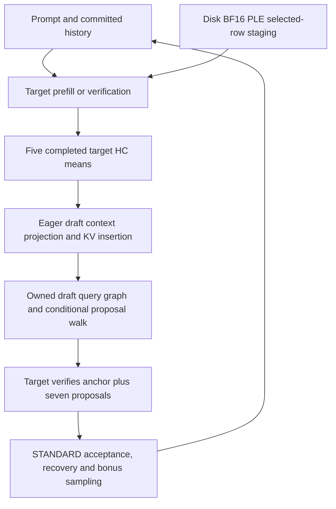

# Qwen3.8 Flash-Next: a practical DFlash2 tuning guide

This guide explains the engineering behind the selected DFlash2 v0.33 runtime: what was tried, what the measurements showed, and why particular implementations survived. The objective was useful speculative decoding on four Intel Arc Pro B70 GPUs while retaining the selected target arithmetic, request-state correctness and model capabilities. The final implementation is **expanded2-exact-v6**, referred to below as **v6**.

The work builds on DFlash2 v0.32, the Disk/MTP5 release and native-MTP research in Qfn-Mtp-vllm33. Results are grouped by optimization area. Historical measurements retain their own workloads and sampling settings; they are not a single cumulative speedup curve. `C1`–`C4` denote concurrent requests, `K` the number of proposed tokens, and TTFT the time to the first content-bearing stream update, which may contain reasoning.

## 1. Runtime, model and correctness boundaries

### Qualification platform

| Component | Selected configuration |
| --- | --- |
| Hardware | Four Intel Arc Pro B70 GPUs, 32 GiB each; AMD EPYC 7443, 24 cores/48 threads; 256 GiB installed RAM; NVMe storage |
| Device stack | Linux `xe` driver and Level Zero; vLLM 0.33.0 XPU; Torch 2.14.0+xpu; Triton 3.8.0+xpu; Transformers 5.20.2; XPU kernel wheel 0.1.15.4 |
| Target | `Intel/Qwen3.8-Flash-Next-W4A16-AutoRound` |
| External draft | `incoai/Qwen3.8-Flash-Next-DFlash2`, original BF16 weights |
| Parallelism | Target TP4/EP4; draft TP4; disk-PLE support qualified at PP1/DP1 with its context-parallel exclusions |
| Serving envelope | Four request slots; 1,024 batched tokens; GPU utilization 0.91; 262,144 input-plus-output tokens per request |
| Speculation | Seven proposals from an eight-position trained query block; support 16; probabilistic proposals; STANDARD rejection sampling |

These resources describe the tested machine, not a minimum hardware specification. Native kernels were built with oneAPI 2026.0.0.20260331; the Intel/SYCL runtime is 2026.1.1. Compiler substitution changes the build. The pinned vendor image fixes binary dependencies but does not attest an exact source revision for every inherited wheel. The pack's [runtime recipe][recipe] supplies the launch and dependency details.

The target has 48 layers: 36 Gated DeltaNet (GDN) linear-attention layers and 12 full-attention layers. Hidden width is 2,560, with four hyperconnection (HC) streams and HC low rank 320. The routed MoE has 512 logical experts, top-10 routing and intermediate width 640. Full attention has 24 query heads, two KV heads and head dimension 256 before TP partitioning; vocabulary storage has 248,320 rows.

W4A16 describes the symmetric group-128 AutoRound routed-expert matrices. Dense projections, HC, embeddings, vocabulary head and other excluded components remain BF16. GDN recurrent checkpoints are FP32; convolution state is BF16. The Intel adapter preserves 2,340 AutoRound exclusions, removes five unused `indexer_*` configuration keys and excludes 128 PLE entries from ordinary loading. It uses dense attention; available QSA/indexer source or checkpoint tensors do not establish a qualified sparse-QSA path. Original checkpoint files and frontend assets remain unchanged.

### DFlash2 and native MTP require different optimizations

Native MTP repeatedly reuses one in-model prediction layer and feeds back its hidden state. MTP5's selected schedule proposed five tokens for one scheduled request and three for batches of two through four. Its prediction layer uses full attention, without target GDN or PLE recurrence.

DFlash2 is a separate five-layer BF16 draft. It consumes completed target layers **5, 15, 25, 35 and 45**, using zero-based indices. Delayed HC injection must be materialized at boundaries 6/16/26/36/46 without consuming or altering the tuple needed by the next target decoder. Each feature becomes `[T,4,2560]`, is averaged over HC streams, and is retained independently. Concatenation produces `[T,12800]`; views into recycled target workspace would be incorrect. Initial integration verified all 81 draft tensors per rank; the nonshared draft payload was about 567 MB per rank.

The draft has width 2,560, 32 query heads/eight KV heads of dimension 128, noncausal sliding attention over 2,048 tokens, a two-tap grouped convolution and a rank-256 selector. Its embedding and output head share original target storage. One anchor plus seven query positions form the trained block. Private MTP heads, feedback fits, whole-expert kernels and dynamic depth policies therefore require separate DFlash evaluation.



### What must remain consistent

For target distribution `p` after request processing and the accepted EOS policy, and the actual conditional proposal distribution `q`, STANDARD accepts a proposed token `x` with

$$
 a(x)=\min(1,p(x)/q(x)).
$$

On rejection it samples from normalized positive residual `[p−q]+`; greedy and bonus branches retain their original rules. Exactness depends on using the same realized conditional `q` for proposal generation and verification. It does not restore an earlier target law after changing target arithmetic. The accepted reasoning EOS guard also deliberately constrains target support.

The proposal cache stores **FP32 raw realized scores**, with absent entries set to `−inf`. Verification applies normalization. Each position clears its previous 16 candidate IDs, writes the new 16 scores and records those IDs. Scores must correspond to the predecessor actually sampled, rather than an argmax predecessor or an incompatible marginal. At C4/K7 the dense cache occupies 27,811,840 bytes per rank; support IDs occupy 3,584 bytes. Sparse updates avoid a full-vocabulary clear each step. The [DFlash2 speculator][speculator] implements this contract.

Acceptance commits state as well as tokens. Target KV, GDN recurrent and convolution slots, PLE n-gram history and draft context must all describe the same prefix. Actual query length and maximum reserved speculative depth are independent. Qualification consequently includes every rejection position, next-cycle recovery/bonus consumption, partial and zero-length rows, poisoned unused tails, reordered requests, cancellation and slot reuse.

## 2. GDN metadata, recurrence and address safety

### Remove repeated preparation without sharing distinct state

Each GDN layer group needs state indices, accepted offsets, query starts and token maps. The original MTP profile appeared to show roughly 38 ms of exclusive host preparation. A cadence audit found 36 builders, rather than the initially reported 40–43, and showed that blocking indexed copies charged previously queued GPU work to the first builder. The useful optimization was common integer staging, with each group's physical state mapping and persistent destinations preserved.

| Investigation | Conditions and measurements | Outcome |
| --- | --- | --- |
| Original per-builder ALIGN fusion | Replaced 11 kernels, eight copies and two waits with one compatible builder kernel. MTP3 cadence fell 43.519→22.562 ms; Base stayed 17.303→17.307 ms | Retained principle, adapted across versions; ragged/prefill fallbacks and distinct group buffers remain |
| Original all-group staging | One pointer-plan launch kept individual output buffers. Isolated staging fell 4.12→0.36 ms, but serving saved only about 0.064–0.075 ms | Small incremental gain after builder fusion; invalidate plans on identity, stride or layout changes, including same-address stride mutation |
| Initial DFlash v0.33 port→B1 | Same seeded 12-prompt-per-level development harness: aggregate C1 87.49→111.06, C2 168.43→199.17, C4 248.26→260.71 tok/s | Retained after 2,880 staging and 864 released-builder comparisons. C4 median request decode could fall while aggregate improved |
| B1→shared metadata recovery | Host metadata 8.578→2.130 ms; target device 20.619→20.275 ms; whole-step event 34.089→29.053 ms | Retained after 4,736 index and 5,472 consumed-field comparisons, state/feature equality and serving gates. These spans overlap and cannot be added |
| Fresh stock 0.6.0: v0.32 / B1 / recovered | Weighted decode 161.75 / 137.62 / 163.12; C1 aggregate 143.04 / 121.85 / 144.06; C4 307.74 / 282.71 / 318.65 tok/s | Restored inherited behavior lost in migration; did not settle every trajectory or prefill difference |
| Separate native-MTP v0.33 all-group retry | C1 108.4→110.9; C2 essentially flat at 184.7; C3 242.6→240.0; C4 281.3→279.3 tok/s | Correct and active, but rejected for inconsistent serving benefit. Different baseline from DFlash's recovery |

V6 retains both per-builder fusion and shared/all-group reuse, narrowly gated to supported XPU DFlash layouts. Fewer preparation calls help when those calls are still on the critical path.

### Address arithmetic and layout are independent safety requirements

The inherited convolution fix widens the state ID **before** multiplying by stride. With the old BF16 stride of 425,984, state 5,042 crosses signed 32-bit range. Casting an already-overflowed product cannot repair it. The original fix passed 19 operator checks and 84 cold long prompts; later ports rebuilt affected headers and returned before dereferencing zero-length inputs. Source/fault-address reconstruction, high-address fixtures and long-context generation each establish different parts of the safety case.

Native MTP also exposed an alternative-layout defect: public DS storage `[blocks,channels,state_len]` could reach a protected kernel whose within-block addressing assumed SD `[blocks,state_len,channels]`. Four intended DS cases failed while SD and DS-as-SD controls passed. Correct 64-bit outer addressing does not fix inner layout. Selected SD remained; general DS support was not repaired or qualified.

Partial verification needed its own native correction. A short query must retain the maximum reserved state columns that a later accepted-offset lookup can address. This underlies MTP5's actual-length metadata repair and DFlash's eight-column contract; importing an old MTP metadata implementation wholesale would be unsafe.

### Recurrence and precision experiments

| Mechanism | What happened | Decision |
| --- | --- | --- |
| BF16 recurrent checkpoints | Seven partial/mixed/rollback cases per rank and changed-input graph checks passed. State bytes halved, but C1 recurrence grew about 16→20 µs and C4 32→57 µs; output NRMSE about 0.00236–0.00253 | FP32 retained; serving state was never switched |
| v0.32 convolution/normalization/recurrence fusion | Core 20.5–20.8→26.7–27.9 µs; serving 242.25→232.41 tok/s despite state checks passing | Rejected; fusion was slower and regrouping changed output/yield |
| v0.32 projection→convolution fusion | A 36-layer actual-weight chain saved about 0.42 ms, but coding fell 270.18→257.39 tok/s and yield 6.5308→6.1633 tokens/cycle | Rejected changed rounding despite a component win |
| Native-MTP Triton recurrence | An initial numerical failure required restoring the native BF16 `a + dt_bias` boundary. Revised 108 actual/mixed/rollback cases passed; best 31.42 µs versus native 12.31 µs | Corrected implementation rejected for performance; tolerance was not loosened |
| Post-v6 re-parallelization, “v7” | VPS2 was exact for output, `z`, convolution and SSM state in 29,448 live calls/rank. Ring timing 19.6→16.2 µs; serving C1 step −0.10%, C2 +0.33%, C4 +0.32%. VPS1 changed bits | Rejected; v7 is not the accepted runtime |
| Deferred recurrent-state materialization | Aliasing eight state columns bounded raw timing at 23.5→16.4 µs. After accepted/boundary materialization before ALIGN migration and APC, estimated net savings were only about 0.1 ms C1/0.5 ms C4 | Production design unimplemented; an estimate, not a serving result |

The original ordered BF16 BA projection above eight rows first repaired v0.32 determinism: all 85 logical state tensors/rank and cold/warm 8K output matched after the change, with NRMSE below 0.00178 against the reference. Before repair, restored APC state already matched and eager suffix execution could still diverge. A proposed MTP transfer was screened out because installed-kernel bit equivalence had not been established; it was not a measured GPU failure.

The successful later projection optimization was narrower: **native ordered `in_proj_ba` for 9–32 rows**, accelerating the existing DFlash arithmetic from about 32.5–52 to 6.6–8.7 µs. Live comparisons passed, and final qualification covered every row count from 8 through 33, including nonmultiples of eight. Rows 8 and 33 use the original fallback. This is selected in v6.

## 3. Graphs, ownership and communication

### Capture the region that removes real overhead

The final command uses `--enforce-eager`, disabling generic runner graph mode while retaining dedicated target and draft-query XPUGraph owners. A draft-manager `NONE` label therefore does not mean the custom query graph is inactive. Conversely, a configured capture size does not prove production dispatch reaches a graph.

The target graph keys are `(n,8n,262144)` and query keys `(n,8n)`, for one through four requests. Pure target verification covers 8/16/24/32 rows; mixed, partial, prefill and unsupported layouts use eager paths. The fixed native-context bound controls capture geometry; actual live lengths still control causal masking.

The first target replay is compared with eager after restoring addressed mutable state, checking hidden output, five target features and recurrent state across all ranks. Query checks compare proposals, complete score caches and touched draft-KV rows. An NaN-tolerant comparison or ignored state tail cannot establish equality if a later consumer reads that data.

| Candidate | Evidence and measurement | Result |
| --- | --- | --- |
| Original v0.30 Base PIECEWISE graphs | At exact p512, temperature 0.7/top-p 0.8/top-k 20/seed 42 and forced 512 outputs, Base rose 7.3059→56.7443 tok/s without `torch.compile`; other depths were similar | Historical dispatch improvement; v6 uses different custom graphs |
| Capture-stream PLE lookup | Moving lookup onto the capture stream repaired a FULL cross-stream event failure; Base p512 56.7443→57.9601 tok/s | Retained old enablement. V6 disk row production remains outside capture |
| DFlash HC leaf capture | Warm-matched six-fixture rate 16.83→23.14 tok/s with 4,524 comparisons | Broader target capture superseded it; the corrected gain is 37.5%, not the earlier differently conditioned 38.9% |
| Full trained block plus target capture | K3/query4→K7/query8: matched short rate 23.75→100.37 tok/s; width-eight eager was 31.65 | Retained after feature/state/recovery equality. Combined depth and capture comparison |
| Concurrent target coverage | Historical coding aggregate C2 82.21→360.59 and C4 159.61→567.51 tok/s after adding qualified 16/24/32-row coverage | Removed an execution cliff; these are not final stock figures |
| v0.33 owned query graph plus ordered HC | Fresh stock 0.6.0 aggregate C1/C2/C4 142.272/216.991/311.904→143.951/234.688/338.446; weighted decode 162.773→162.062 | Combined concurrent-serving improvement retained; component attribution unavailable |
| Draft context feature/KV capture | Hidden/KV equality passed; standalone development C1/C2/C4 130.50/216.55/284.80, with mixed combined repeats | Input copies offset submission savings; context projection/KV insertion remain eager |
| Target live aliases and persistent draft metadata | Replacement/in-place gates passed and four metadata shapes activated, but combined repeats varied substantially | No robust additional serving win; original staging retained until later host-path work |
| Rank-local DFlash target-head capture | 1,088 exact comparisons and all rank masks passed; local eight-row projection about 0.550→0.565 ms, with mixed serving results and about 10.3 MB persistent storage | Rejected; MTP's successful local-head integration did not transfer as a DFlash speedup |
| MTP short-HC leaf capture | 124 standalone comparisons and nine startup captures/rank passed; first real 8K prefill equality check failed | Rejected before accepted serving measurements. Failing bucket/tensors were not saved, so the cause remains unresolved |
| Earlier v0.32 query capture | Proposals, full-q and query KV exact; revised endpoint 268.06 tok/s represented only about 0.14 ms/cycle saved | Rejected then; v0.33 independently redesigned ownership |

The retained query graph captures the five draft layers, head, selector, conditional walk and cache writes. It owns tensors and model objects, validates bindings, and coordinates graph presence/eligibility across ranks. An early frozen graph version was superseded after stronger retention of producer objects; weak-reference/GC and asymmetric fallback tests cover those boundaries. See the [query graph implementation][graphs].

### Why pointer lifetime and rank agreement mattered

MTP's metadata-prologue graph first passed 30,240 metadata comparisons, then left the target reading **24/24 stale state indices** after output replacement. Invalidating the producer alone was insufficient. The ownership repair retained output owners and invalidated both producer and consumer; it passed 1,152 metadata comparisons and 32 FULL replays, then exposed another defect: one rank selected eager five-row execution while others selected PIECEWISE six-row execution. The dispatch gate rejected it before unequal collectives ran.

A graph containing collectives needs agreement before padding, capture, replay and fallback. A collective-free local head can make a different local graph/eager choice if every rank subsequently enters the unchanged eager gather with identical geometry and order. MTP proved this boundary, but its first wrapper integration activated zero graphs. Resolving `.language_model` subsequently produced 14,681 replays/rank and 192 successful stock requests. Configuration and standalone equality had not proved activation.

A separate DFlash comparator retained graph metadata and recurrent rows after a request retired, but lost ownership of its attention KV. An intervening request recycled those pages; old tails became nonfinite. The repaired comparator runs while KV is owned, restores mutable state and checks baseline against itself first. Stale replay timings were discarded as harness failures.

MTP's exact 12/16-row capture extension also illustrates architecture-specific coverage. Avoiding padding to 64 rows improved stock C3 201.5→231.2 and C4 249.8→273.6 tok/s, at a cost of 2,942 KV tokens and worse C1–C3 TTFT tails in one pair. DFlash already had 8/16/24/32 coverage.

### Collective choices changed arithmetic as well as latency

Initial vector verification reduced four serial target calls from 554.74 to 160.04 ms in a diagnostic, but an ordinary width-four collective changed hidden state substantially relative to the serial oracle. Canonical row-partition BF16 reduction preserved the established one-row order through packed rank-quarter communication. A combined short C1 pair rose 100.15→132.66 tok/s with identical text. V6 retains that policy.

Grouped XCCL capture then returned four times the expected sum across 32 iterations/rank, despite eager correctness; an uncoalesced control passed. A breakable target prototype with 147 segments/146 eager breaks stalled after about two persistent replays. The dedicated target owner uses the qualified uncoalesced/canonical route. These are failures of particular implementations on this stack.

| Alternative | Observation | Decision |
| --- | --- | --- |
| Custom TP4 peer writes/reads | Against a 23.2 µs native collective, peer writes took 123–141 µs and peer reads 36 µs; endpoint 182.34 tok/s. Unsafe polling/notification designs were excluded before serving | Rejected tested designs; no general TP4 hardware limit follows |
| Raw buffered rank reductions | Saved about 1.5–4 µs/collective but changed BF16 order, NRMSE about 0.002. Final fast-policy C1 223.77 canonical versus 224.10 raw did not establish a repeatable advantage | Canonical retained. An initial equality comparison mixed declared policies and was invalid |
| MTP low-latency threshold/buffers | Six-row all-reduce 21.90 µs with current settings versus 28.82 µs at threshold zero. Disabling temporary buffers caused DEVICE_LOST on 16-row gather; enabled controls passed after driver recovery | Retain threshold 65,536 and both temporary-buffer settings enabled |
| Older MTP q4 reducer | Four 64-thread workgroups/head, tightly guarded geometry, compact 1/32/64 live split metadata. Combined warm-generation gains about 1.8–2.9%; separate archived native/reducer/threshold arms had differing trajectories | Useful MTP lineage; not DFlash's fixed-32 attention path |

The older reducer's first collective could include milliseconds of waiting for preceding work. Per-rank overlapping clocks cannot be summed into an optimization budget. An archived 64K coding example even favored native 150.1768 over LL64K 146.2982 tok/s with identical output/round/accept counts; the combined receipt is cohort-specific.

## 4. Native kernels and the numerical target

BF16 input/output types do not specify reduction order, intermediate casts, dequantization multiplication or transcendental behavior. Four separate claims matter: implementing a quantized operator correctly, approximating a higher-precision reference, matching graph/eager execution, and preserving useful model behavior. One passing gate does not imply the others.

### HC: preserve partial sums when fidelity is required

The original Base/MTP wide-prefill corruption was localized to HC, not collectives. At 256 rows a repeated identical-input oneDNN projection produced roughly 395–508 fingerprints in 512 runs. An N-contiguous layout also raced at 64 rows. Wide or padded captures damaged later needle/vision output despite apparently healthy, finite execution. Restricting graphs to 32/48 rows was a temporary bracket; 48-token prefill chunks passed needle and vision tests but worsened TTFT by 42.5/25.3/39.7% at p512/p4096/p8192.

MTP's selected repair uses two K5120 BF16 linears plus a BF16 add above 64 rows, leaving smaller rows unchanged. It produced zero flips in 512 stress runs; its roughly 4.3–4.7 µs/operator cost enabled safe 256-row prefill capture and approximately halved TTFT. This establishes MTP's arithmetic contract, which differs from DFlash's later ordered full-K path. A source-screened transfer witness gives **0 with half-result rounding versus 1/256 with full-K accumulation** for valid weights; preserving dtype alone would change that target.

DFlash v6 instead retains 80 ascending K128 partials for 1–8 rows and 160 K64 partials for 9–32 rows, followed by the existing sequential FP32 finish. Ordered HC v2 uses a bounded 40 KiB local finish instead of a global partial buffer. Split 20 wins generally; split 10 is selected only at 32 rows. The kernel passed 8,660 actual-weight/changed-input comparisons and 3,104 real-request checks. Eight-row timing improved about 18.7→15.6 µs, and 24-row timing 28.1→17.9 µs. The 32-row split change later saved about 1.7 µs/component.

| HC alternative | Finding | Result |
| --- | --- | --- |
| Parallel-K or transposed storage | Parallel accumulation changed BF16 results; a faster transposed microbenchmark lost in serving | Rejected |
| Duplicated packed HC layout/wider fusion | Extra 635,699,200 bytes/rank reduced KV capacity 4.2%; wider fusion took 25.4 versus 12.6 µs | Direct original-weight addressing retained |
| TP-sharded HC down | Extra roughly 21 µs collective at each of 97 boundaries changed the chain 1.810–1.825→3.174–3.177 ms; NRMSE 0.001651 | Communication exceeded removed work |
| Persistent/partitioned down+SiLU | Chain improved about 1.89→1.74–1.76 ms, but integrated rate fell to 234.70 tok/s with yield 6.011 | Rejected changed arithmetic/yield |
| Exact finish+SiLU / extended up-mix | Finish saved roughly 1.4–1.7 µs without meaningful C1 benefit. Up-mix saved about 0.6 µs at 16 rows but lost 2.5 µs at 32 | Neither selected |
| MTP native HC and its DFlash transfer | MTP six-row block 30.85→17.45 µs in a synthetic probe; live maximum NRMSE 0.252%, with finite code/capability passes. DFlash trial C1 134.72→149.25 had nearly unchanged 23 ms intervals; clean combined retest gave 144.24/208.84/302.19 C1/C2/C4 | Useful MTP approximate path; excluded from fidelity-preserving DFlash v6 |
| MTP fused up/gate/mix or FP8 HC | Actual-weight fused six-row probe 57.0 versus 14.9 µs. FP8 down/up NRMSE about 3%/2.7%, saving only 0.45/1.2 µs per projection | Rejected tested implementations |
| Early MTP gate/HC diagnostic | Gate kernels were slower across tested widths; modest small-decode gains did not offset much slower prefill. Original graph/eager one-ulp differences were retained | No global transfer selected |
| Later exact HC-down redesign | Four weight-sharing/K-group layouts over 24,000 real-weight calls all lost at 16–32 rows; an apparent small-row gain failed the mixed 97-module ring | Ordered HC v2 retained |

### Expert ownership is part of the numerical baseline

Original EP placed 128 whole experts on each rank. DFlash v0.32 cyclic ownership keeps every expert's five intact 128-wide quantization groups, assigns global group `G=5e+j` to rank `G % 4`, and stores 640 groups/rank. Startup exchanges packed weights/scales byte-for-byte into views of the original allocations. The model still has 512 logical experts, top-10 routing and one complete-output reduction per layer.

This balances routes but changes where BF16 down partials round. It became the qualified **DFlash target baseline**, rather than an exact whole-expert MTP replacement. Coding rose 244.27→266.55 tok/s, cycle time fell 25.503→24.501 ms and yield rose 6.2296→6.5308. Holding old yield fixed predicts only 254.26 tok/s, showing that execution and trajectory both contributed. Startup grew 22.15→65.25 s; 8K/65K TTFT regressed, C4 aggregate fell 0.75%, and capacity initially fell.

Consumer-scoped metadata later reduced logical staging from 84.610 MB to 61.5 KB/rank, saved about 0.330 ms/cycle and increased capacity 483,026→491,165 tokens; coding rose 266.55→270.41 with identical output/yield. Compact prefill workspace packed each token/expert once, reducing 1,024-row main scratch 225.528→166.776 MB/call with roughly unchanged TTFT. Later specialized consumers superseded some ranges.

The final dispatcher uses an eight-row C1 dominant W4 layout, compact 16/24/32-row consumers, short irregular `serving_prefill8`, long 257–1024-row `long_prefill_v3`, and fallbacks. Earlier native K64 small GEMM and direct-token whole-expert/HC addressing established useful infrastructure: historical cycle 27.20→26.51 ms and C1 236.05→242.25 tok/s, respectively. Their loaded libraries may remain for ancestry/fallback; their ordinary whole-expert routes are not thereby active in v6. Bounds-checked global/local remapping also remains a safety lesson: check IDs before offsets and avoid negative excluded-row pointers.

The eight-column gather transfer into native MTP was redundant: its installed `MoeGather<BF16,10,8>` already shared route metadata. Source/guard checks did not constitute a new benchmark, and cyclic group rounding could not replace whole-expert K640 rounding unchanged.

| Expert-kernel alternative | Measured finding and outcome |
| --- | --- |
| Whole-expert stripes, FP32 partial exchange, paired subgroup ownership | No consistent stripe proxy benefit; FP32 reduction chain about 0.83→3.44 ms. Preserving whole-expert rounding added costly communication; cyclic groups retained |
| Whole-expert contiguous/roundrobin/compact transfer into DFlash | Byte-exact redistribution round trip, but actual C1 cyclic about 78.17 µs versus 95.47 contiguous/85.14 roundrobin; wider variants also lost, with changed partial rounding |
| Native-MTP learned placement/repartition | All logical weights/scales verified; development C4 sometimes improved, but matched C1 placement screens tied, prefill could be 6–9% slower, and rank-sum rounding changed. Final MTP experiment preferred original ownership |
| v0.33 alternate cyclic dispatch/scales | Reusing `serving_prefill8` at verification widths passed 1,536 actual-weight comparisons. Warm C2/C4 improved 3.6/3%, but fresh-launch C4 regressed; transposed scales/long-prefill variants were slower. Original specialized dispatch retained |
| Cooperative v0.32 producer/consumer | 384 exact real cases; 48-layer chain 5.035→4.982 ms, but whole target usually 0.124–0.609 ms slower and endpoint about 271 tok/s tied controls. Lost scheduling parallelism outweighed removed traffic |
| New cyclic fusion, partitions 1/2/4 | 216 actual-weight cases exact; uniform baseline 135–136 µs versus fused 136–221, concentrated about 35 versus 40–52. Rejected before serving |
| MTP complete-expert small / 16-row extension | Small 1/2/4/6/8-row path passed synthetic and 48-module/rank live gates and was selected in MTP; exact 16-row extension regressed both route patterns |
| MTP full expert fusion | 105 exact cases; six-row uniform about 123 µs versus 218–236 fused. Partition variants duplicated gate/up work; rejected |
| Paired gate/up | Initial comparison withdrawn for duplicate SYCL kernel names. Corrected unique-namespace six-row uniform 124.23→126.82 µs and concentrated 262.62→286.88; eight rows also slower |
| Wider K128 tiles, column-major nibble layout, GRF128 | Exact variants did not improve consequential full routes. GRF128 six-row uniform 123.55→128.10 µs despite smaller-row gains; dominant target retained GRF256 |
| Installed ARK route | Six-row uniform 119.4→269.0 µs, NRMSE 0.007775; rejected |
| ESIMD variants | v2 failed fixed NRMSE gate, 0.007896 versus 0.005. Explicit RTZ BF16 dequant multiplication made v3 exact but 125.894→192.990 µs. v4 built but GPU JIT failed `IGC map::at`. v5 exact, 126.233→167.549 µs uniform and 261.463→326.306 concentrated |
| Scale after group / W4A8 | Changing dequantization order gave maximum 0.7775% NRMSE and modest six-row gains, 122.68→116.34 µs uniform; no full-model qualification. W4A8 variants are discussed below |

Unique SYCL kernel type namespaces across DSOs were necessary for trustworthy comparisons. An initial full W4A8 route hit DEVICE_LOST while reusing reference names; the corrected namespace passed device-health and route checks. A successful host link alone did not prove independent accelerator kernels. This evidence does not explain every device fault in the campaign.

### V6 MoE fusion: fixing the rare N=1 discrepancy

The selected front fuses router logits, shared gate/up with SiLU-product, and the shared-expert gate logit; the back computes shared down and sigmoid-gated output. Routed selection/computation, routed-plus-shared addition and TP reduction retain their existing contracts. Dispatch requires contiguous BF16 `[M,2560]`, M=8/16/24/32, 64-byte input alignment and expected module/weight shapes. A per-block stash belongs only to its matching input object and is cleared at entry and consumption.

The first v4/v5 kernel used a straight FP32 DPAS chain for the N=1 gate projection. That image reported glue timing 29–31→19–20.5 µs/layer and development step reductions of 2.8/2.2/1.4% at C1/C2/C4, but its exactness claim did not survive. Initial **2/768 shared-output mismatches** remained real despite later 0/3,840 samples. Absorption probes using `2²⁴, 1, −2²⁴` identified the installed oneDNN schedule: 16 step partials, each chaining five 32-wide chunks at `k=blk*512+j*32`, then summing the 16 partials left to right. Straight-chain accumulation disagreed by one BF16 ulp in roughly 2×10⁻⁴ of stressed rows.

Live forced-eager v5 reproduced 31 gate-logit and 30 shared-output mismatch events/rank in 30,096 calls, without nonfinite inputs, stale stash or misalignment. An exact intermediate v2 kernel was about 1 µs/layer slower. Final native **v3** computes two partials on each of eight subgroups and disables reassociation/contraction in the finish. It recorded zero mismatches in 1.2 million offline rows/60,000 calls and 36,000 live calls/rank. Front+back improved 16.6–18.1→12.8–15.2 µs/layer; an in-engine ABBA improved C1/C2 step about 0.76/0.86%, with C4 overlap/noise. This corrected kernel is in v6; the earlier exactness claim is superseded.

The original two failed tensors were not saved, so their attribution relies on reproduced mechanism/signature. Exactness also has a numerical domain: subnormal partials can be preserved where oneDNN flushes, and NaN payload/sign can differ. The alignment guard addresses an observed address-dependent difference. Those residual domains did not occur in normal-serving gates. BF16 SiLU/sigmoid element formulas were checked over 65,280 finite inputs; that is narrower than universal model equality. See [the native MoE implementation][moe].

Other exact proposals lost: Triton MoE front took 33 versus 18.7 µs, large-N native projections did not beat the measured bandwidth-bound route, larger DPAS K tiles and HC split 40 gave no gain, and a softmax rewrite could not match installed FP32 exponentials. Native-MTP dense projections likewise passed 224 actual-weight cases, but an eight-weight ring was 0.225860 versus 0.222443 ms; a 0.6076 µs/layer isolated output-projection saving was insufficient.

## 5. BF16, FP8 and INT8 experiments

### An exact BF16 convolution fusion survived

The draft's two-tap convolution originally materialized coefficient, product and accumulation boundaries separately. Its retained Triton fusion preserves the sequence:

```text
coefficient = BF16(base_weight + grouped_delta)
term        = BF16(coefficient * input)
output      = term_for_tap_0
output      = BF16(output + boundary_masked_term_for_tap_1)
```

Request-boundary masks and intermediate BF16 casts remain; floating-point fusion is disabled where it would remove a cast. Across ten modules, 220 cases/rank and 160 actual-input checks, the fusion preserved results while reducing about 18–20→5–7 µs/call. A development update interval fell 22.971→22.696 ms. It runs inside the selected query graph; checkpoint weights remain unchanged.

### Target quantization and proposal quantization have different consequences

A quantized **proposal** can remain compatible with STANDARD if verification uses its actual `q`. Quantizing the **target** changes `p`, regardless of the verifier. Approximate operators also need model-level tests: an integer arithmetic oracle can pass while alias independence or required tool behavior fails.

| Investigation | Performance and numerical findings | Outcome |
| --- | --- | --- |
| FP8 all target attention projections | Synthetic projection time about halved, but actual output-projection NRMSE reached 0.113402, above the 0.1 gate | Rejected full path after correcting an initial module-name lookup error |
| FP8 input-only target projections | 48 input modules; 3,648 live checks/rank, maximum local NRMSE 0.0154401 and no nonfinite inputs | Used in the fast candidate, then removed after code-quality isolation and the campaign's no-FP8 decision |
| Private FP8 draft head | Extra 159,173,120 bytes/rank; component 0.547→0.286 ms, about 2.7% logit NRMSE; actual-q cache checks passed | C1 reversal 221.46→216.82 tok/s lost despite concurrent benefits. Concurrent-only mode survived the fast/first-repair images, then clean BF16 reconstruction removed it |
| Early dense INT8 HC/projection pipelines | Full quantize/matmul/rescale: HC down+SiLU about 21.5 versus 12.5 µs, up/mix 13 versus 10; attention 17.5 versus FP8 comparator 13 | Rejected pipeline cost; primitive availability was insufficient |
| INT8 HC up-only retry | Actual 17-weight ring 0.593→0.573 ms. Initial recapture hit `CachingHostAllocator`; separate graph families fixed lifetime. Corrected C1 off/on/off 222.17/215.11/222.64 tok/s | Rejected corrected serving implementation |
| Private INT8 draft head | Extra 159.2 MB/rank; component about 0.55→0.31–0.35 ms, 1.05–1.09% NRMSE. Code, four aliases and growing-history checks passed | Standalone C1 137.70→136.70; calibration+convolution combination lost C1/C4. Excluded |
| INT8 target GDN input | 36-weight ring 1.39→1.10 ms, 378,077,184 derived bytes/rank. Three tie-near quantization errors produced ±63 instead of ±64 | Native round-to-nearest repair cost 2.64 ms; Triton `div_rn` restored 1.10 ms and 72 actual oracles/rank passed, but 3/4 alias checks failed against passing BF16 reversal. Rejected before valid serving timing |
| INT8 target vocabulary head | Component about 0.55–0.57→0.31–0.35 ms; maximum actual logit NRMSE 6.16%. All 31 code and four alias cases passed | Omitted a required temperature tool call and failed follow-up conversion; BF16 reversal called the tool and returned 12°C→53.6°F. No candidate performance qualification |
| Native-MTP W4A8 experts | Groupwise INT8 activations×INT4 weights passed quantized-oracle and graph/eager gates; initial approximation 0.6–0.8% NRMSE, full-route maximum about 1.8%. Corrected six-row uniform 124.11→116.42 µs; K64/K128 about 111–112 versus 124 µs | Modest route savings, roughly 0.6 ms possible across 48 layers before model-quality costs; no selected full-model deployment |
| DFlash cyclic W4A8 | Same 640-group ownership, but changed target activation arithmetic; actual K5 global NRMSE 0.023506. C1 about 199.41 tied, C4 about 445 versus 476.60 tok/s | Rejected serving result; no W4A8 path in v6 |

The target-head fixture initially permitted prose when a tool was required; manual review caught the omission and strengthened it. In another code isolation, removing target FP8 restored merge-patch completion but left aliased output; restoring the original selector separately repaired independence. A malformed `query` instead of `queries` argument was already present before parsing, but three FP8/three BF16 frozen controls did not reproduce it. Its cause remains unresolved.

An intermediate conversation repair restored STANDARD, score 1, the BF16 target and original selector plus EOS guard. It passed 12 frozen, 15 growing and 22 heldout turns, with 31 code cases and 21/32 reasoning; stock 0.6.0 aggregate C1/C2/C4 was 144.2009/226.6801/332.2378 tok/s, about 33.4–35.6% below the fast image. It still carried the concurrent private FP8 proposal head.

The clean reference was then reconstructed from pre-FP8 ancestry with the accepted EOS repair, original shared head and original selector. It produced stock 0.6.0 aggregate C1/C2/C4 147.5928/226.8599/321.0970 tok/s and 461,259 KV tokens. Auditing model allocations/dispatch distinguished inactive vendor format support from an active FP8 model path. V6 descends from this clean chain. These findings concern the tested implementations and hardware; they do not rule out useful FP8 or integer designs elsewhere.

## 6. Proposal quality, depth and verification policy

### Calibration improved alignment, with workload-dependent returns

V6 retains the checkpoint selector and shared BF16 vocabulary head. It adds 14 frozen scalars, two per proposal position:

$$
 S'_i=a_i u_i+b_i(S_i-u_i),
$$

where `u` is the unary candidate score and `S−u` the predecessor-conditioned correction. The `[7,2]` artifact is validated for identity, shape, finite values and K7/support16/scale1 compatibility. First-position residual weight is approximately 0.25; later weights are about 0.78–0.90. The packaged tensor defines exact values.

Training used 42 requests, six validation and 16 untouched holdout requests, independent of BetterBench. Across 33,642 aligned position rows, weighted validation overlap rose 0.535795→0.539422 and holdout 0.606743→0.610180. Initial seeded development C1 was 150.267 versus 136.581 tok/s, mainly from better return/acceptance rather than shorter target execution.

Clean calibration+convolution stock 0.6.0 runs gave **145.240/151.252 C1 versus 147.593 reference**: no repeatable C1 improvement. C2 improved 3.1–4.1% and C4 4.6–11.0%, with broad spread. At 9,081 prompt tokens one diagnostic helped C1 80.27→94.40 but hurt C4 223.33→214.16; category diagnostics helped math while hurting reasoning/summarization. Calibration changes proposal alignment, not universally execution speed.

| Proposal alternative | Finding | Outcome |
| --- | --- | --- |
| Wider support 32/64/256 | Actual conditional-q replacement and slot/cache gates passed. Early STANDARD C1 about 134.71/141.78/135.12 tok/s; a lossy support-64 arm reached about 206.76 | No robust new winner; support 16 retained |
| K3/K5 instead of K7 | v0.32 matched short C1 143.90/164.79 versus K7 178.50. Later K3 with trained eight-position query block STANDARD C1/C2/C3/C4 125.38/216.83/277.06/322.43; lossy K5 about 199.41 versus K7 above 215 | Metadata/state support worked. Query4 changes trained context; no dynamic DFlash schedule selected |
| Selector score 0/2 or aggressive sharpening | v0.32 selector off/double about 228–229 versus original 233.4–233.6 tok/s, with top-16 coverage 658/663. Later scales 2/8/16 and alpha sweeps did not improve the fast choice | Original selector/global scale retained for final STANDARD path |
| Full learned selector | v2 selected identity. v3 validation 0.580088→0.585297, holdout 0.608859→0.625469; seeded STANDARD 137.32→154.14 | Clean BF16 retest passed 31 value cases but failed all four independence/alias checks; original restored |
| Lossy selector channel fit | 256 scales under alpha 1/128/score 4: holdout relaxed acceptance 0.745380→0.749575; K5 development 203.89→207.24 | Small gain under altered law; not adopted |
| Unary hidden/head fits | Four ridge and eight low-rank fits evaluated with full-vocabulary conditional scores. Best nonidentity relaxed acceptance 0.857145 versus original 0.863069; STANDARD 0.676390 versus 0.681645 | Rejected on validation before holdout; candidate-pool coverage was misleading |
| Joint unary/selector fit | Holdout relaxed acceptance 0.887389→0.891077; 378 actual-cache positions/rank passed | Serving reversed 220.69→211.41 tok/s; original restored |
| Broader request-balanced scalar refit | 91,637 positions, 42 train/six validation/16 fresh holdout requests, nine 2/4/14-parameter fits. Validation barely improved 0.510952→0.510972; holdout fell 0.626085→0.625835, with 12/16 requests lower | Rejected offline; no serving result or post-holdout fitting |
| Exact occupied-block q statistics | Kept dense 27.8 MB cache and full-vocabulary recovery, skipped provably empty blocks. C4 verifier 0.173→0.142–0.143 ms; actual-statistic gates passed after correcting an undefined-tail oracle | Repeated off/on serving gain absent; source only |

### Native MTP established different depth and head economics

The old v0.26 accelerated Base reached historical medians around 45.3 tok/s at p512/p4096/p8192, but MTP RingTransmit stalls and APC/compiled-prefill corruption led to rebasing on v0.30. Original workspace loss limits those figures to surviving recipe evidence.

On v0.30, one MTP iteration gave 47.47/48.73/47.16 versus Base 57.92/57.85/57.38 tok/s. Its step-cost ratio 2.32 exceeded the maximum two returned tokens. Reusing the layer three times was legal and more promising: untuned MTP3 57.16/64.10/78.63, with separate optimized receipts 111.26/149.25/153.74 tok/s. Functional support and performance selection were separate decisions.

MTP5 then fixed actual query length versus maximum reservations, retaining six state columns. Its K5-at-C1/K3-at-C2–4 schedule improved an original release-candidate comparison from 113.21→116.77 C1, 101.53→180.36 C2 and 153.62→242.62 C4 stock 0.6.0. That was correctness/dispatch recovery, not evidence for dynamic DFlash K. A v0.33 K4 middle-concurrency retry gained 3.9% at C2, lost 1.4% at C3, reduced acceptance 50.29→47.42% and added nine length stops; 5/3 remained.

| MTP proposal/head study | Conditions and result |
| --- | --- |
| Greedy refined head→probabilistic K5 | With TP4/EP and development temperature 0.7/top-p 0.95/top-k 20, greedy combined aggregate C1/C2/C3/C4 was 116.1/194.5/256.6/282.5. Full-support FP8 proposal logits plus STANDARD gave 133.3/203.9/265.4/334.2 |
| K3/K7/K15 | Greedy K3 115.1 versus K5 116.1; probabilistic K3 125.717 versus K5 133.312. Working K7 with 1,200 metadata checks reached 122.9 C1 and lower capacity. K15 passed metadata/joint-law gates but reached only 92.373 C1, 38.060 ms/update, 3.583 returned tokens/update |
| Refined/sparse proposal variants | Global top-k shortlist/rescore was slower than blockwise refinement. A later probabilistic sparse-refined screen gave 127.78 versus stored 133.3 C1, but overlapping CPU build work prevents a causal regression claim. Sparse probabilistic proposals are not inherently invalid if actual q is retained |
| Proposal windows/sharpening | Actual transformed-q/Gumbel/cache tests passed eight×32,768 trials. Top-20 processing cost 0.19–0.31 ms/draft step versus scale-only 0.013–0.023 ms. First-position overlap 0.80569→0.80776 with window 3 and 0.81258 with scale 1.5/window 3 did not translate to robust C1: sharpened 127.099, unsharpened initial 138.4 then 130.0 on repeat. No cutoff selected |
| BLOCK verification | Twelve×32,768 three-token Markov cases passed full joint-law gates; a biased case returned 2.66 versus STANDARD 2.15. Serving C1–C4 130.374/206.970/267.770/288.420 did not win C1; no stock rerun |
| FLy K15, window 1/entropy 0 | C1 125.996 improved over K15 STANDARD, still below retained K5; joint TV distance 0.0804–0.1548. Explicitly lossy and rejected |
| Sparse learned MTP head | Rank-256 FP8 coarse scoring, eight candidates per 128-word block and original BF16 rescoring. Proposal buffer 159.2→30.6 MB/rank. Overlap training selected validation 0.599607→0.605192 and holdout 0.663422→0.674865 from 42 fit/six validation requests |
| Feedback and conditional fits | MSE improvement degraded native-head overlap; direct CE selected step zero. Rank-128 feedback correction, 5.3 MB/rank, gave C1 109.661 at alpha 1/134.577 at 0.25, so original feedback remained. Later conditional rank 128 holdout 0.686007→0.691346 and rank 512 0.689176 were marginal, undeployed proxy gains |

The final native-MTP experimental checkpoint combined its approximate HC, sparse learned proposal head and original expert ownership. Full stock 0.6.0 C1/C2/C3/C4 was **146.860/233.930/280.374/334.125**, weighted decode 161.763, prefill within 0.4% of reference, capacity 317,430 tokens, and 74/160 single-stream empty finals under stock caps. Code/capability/full-budget/reuse gates passed, but the 350 tok/s C1 goal remained unmet and it was not promoted. It is not DFlash v6.

### Relaxed acceptance and FLy change the output law

The tested alpha rule accepts with `min(1,p/(alpha*q))` while retaining positive `(p−q)` recovery. At alpha below one its output law is

$$
 \min(q(x),p(x)/\alpha)
 +\left[1-\sum_y\min(q(y),p(y)/\alpha)\right]r(x),
$$

which deliberately differs from STANDARD. Three-token Markov tests with repeated recovery, sparse support and 32,768 trials/case confirmed STANDARD/BLOCK target-law agreement and increasing relaxed bias: illustrative joint TV about 0.159/0.384/0.578 at alpha 0.5/0.25/0.125, and about 0.155 for a tested FLy arm. Support preservation is insufficient for distribution preservation.

FLy is distinct from alpha relaxation. It keeps an original rejection pending and forgives it only after the following `W` proposals all pass native verification and the entropy gate permits it. Failure recovers at the original row; an intervening rejection does not rescue that window. The released entropy is `H_k = −sum(top-k p log p)` in nats, normalized over full effective support, without renormalizing the subset or dividing by log vocabulary. Defaults k=3, threshold=0.3 and W=min(6,K−1) do not share the paper's normalized-entropy scale. Uniform vocabulary 248,320 gives H3≈0.00015008. K7/W6 can forgive only the earliest eligible rejection. None of these gates establishes semantic correctness or a general quality-loss bound; old disk/config guards and a custom greedy bypass also required integration work.

The fastest DFlash serving-v4 used target input FP8, concurrent private FP8 head, score 4 and alpha 1/128. Two stock 0.6.0 runs gave C1 **223.22/223.74**, C2 **344.18/340.28**, C4 **510.77/516.27** tok/s; one weighted category score was 259.37. A separate personal run gave 229.07/316.88/461.11 and weighted 253.54; its LAN handback reused that run. Code scored 30/31 versus protected 31/31, failing capacity-zero LRU.

A captured second turn was more decisive: 9,191 prompt tokens, 8,730 shared with turn one, temperature 1/top-p 0.95/top-k 20, xhigh, 36 tools and a 32,000-token ceiling. Five relaxed controls failed across cold/warm, fresh/reused slots and BF16 target restoration, ending reasoning on EOS without a final. Zero-hit APC controls showed reuse was unnecessary; raw decoded output showed the parser did not hide a final. Same-logits/q/draw comparison found the first policy fork at generated index 2: relaxed accepted token 369 (` is`) with p=0.622006 and q=0.999949, while STANDARD rejected and recovered token 6587 (` wants`). This identifies a verifier contribution, not the exact onset of repetition. Restoring STANDARD made frozen turns 2–5 answer.

Guarded clean-BF16 alpha values 1, 0.9, 0.75 and 0.5 tests then separated policy from FP8. Alpha 0.75 failed to finish merge-patch within the cap, also seen once in control. Alpha 0.5 passed authored tests but took 172.513 s with repetitive deliberation and failed manual usability review. Alpha 0.9 initially gained 3.44/8.95/11.58% aggregate C1/C2/C4; a fresh pair reversed to **−2.36/+1.22/−2.44%**. Qualification checked scores were 11/14 and 10/14 versus STANDARD 10/14 and 9/14; capped missing finals were 16 versus 18 over 116 captures/arm. A focused C4 tool omission lacked a fresh matched STANDARD counterpart when work stopped. These finite unseeded samples prove neither broad equivalence nor a population quality penalty. No repeatable useful advantage survived; alpha 0.9 remains research only.

Lower alpha 0.875/0.85/0.80 and standalone clean-STANDARD sharpening were not run. An offline scale 4 proxy lowered overlap 0.74417→0.72201, but it is not a serving qualification. V6 selects STANDARD and score 1.

### The EOS guard repairs a separate failure

STANDARD did not prevent every premature stop. A held-out seed-one history returned the same 64 IDs on a fresh protected pre-lossy image and conservative candidate, ending on EOS 248046 before end-think. Raw EOS logprob was −2.439163, about 8.7% before filtering. This behavior was permitted by the original target without FP8, relaxed verification or APC reuse.

The selected guard masks configured EOS only while the **initial rendered reasoning segment** remains open. It tracks committed/speculative marker prefixes, resets/resumption, tool openers and closure; literal markers later in final prose or tool arguments cannot reopen it. Actual think/end-think/tool IDs are 248068/248069/248058, EOS 248044/248046. In the witness the first 63 IDs matched, newline replaced EOS, and a correct final stopped normally at 97; guard-off restored failure and 96 finite seed checks answered.

This is an explicit support constraint, so STANDARD is exact relative to the selected constrained target. The guard neither forces an answer nor closes reasoning, reduces caps or applies repetition penalties. It cannot prevent 32,000-token thinking exhaustion. Default thinking-budget/presence changes and n-gram repetition termination were separately rejected: they alter generation or can stop valid output, and do not repair numerical correctness. A nested reasoning-effort adapter remained protocol-level research, with its broader template support unqualified. See [the reasoning-state implementation][thinking].

## 7. Host overhead, PLE and memory residency

### Optimize the exposed submission gap

On the clean calibration+convolution C1 path, a 22.92 ms step included about 12.4 ms waiting in PLE D2H while earlier GPU work drained. After that drain, an exposed 1.64 ms GPU-idle gap remained: roughly 0.33 ms PLE preparation and 1.26 ms target-graph host work. The input update walked 49 metadata objects/187 nodes in about 0.86 ms and submitted 127 tensors/61.5 KB in about 0.39 ms. Draft-query host work followed target submission and was hidden behind about 19 ms target execution; removing its safety vote was unjustified.

The retained compiled update specializes the captured destination tree into straight-line Python, preserving walk/copy order, exception classes, CPU copies and identity-dedup behavior. A fused Triton byte-copy batches eligible contiguous pairs through a cached pointer/size table. The strided int64 `[n,8]` view with row stride 1,025 keeps foreach copying. Source-pointer replacement refreshes the table; first use checks every destination byte, and mismatch permanently falls back. Host preparation failure also retains the original route.

| Host-path test | Finding |
| --- | --- |
| Compiled walk | 214/214 live replay pair lists matched original identity/order; 11 schema/fault cases matched exception classes. Target host work 1.26→0.56 ms; exposed gap 1.64→0.86 ms |
| Fused eligible copy | 177/177 live-swapped and 172/172 final-image submissions had all 127 destinations byte-equal, including replaced/in-place/mixed/zero-byte cases. Copy host time about 0.22→0.05 ms; combined gap reached 0.60 ms |
| Repeated development steps | C1/C2/C4 median intervals improved 4.4/3.4/3.3%. Aggregate returned rates changed +3.5/+5.8/−5.3%, showing trajectory/tail sensitivity rather than a uniform throughput gain |
| Deferred PLE preparation | Queue graph-input copies before blocking gather/drain for eligible uniform verification. Same device operations/stream; thread-local pending prepare flushes in `finally`, before eager/capture and on stale work. About 0.27 ms host overlap; development steps improved another 1.6/1.6/1.0% |

Two failed revisions explain the guards. Positive USM pointers above 2⁶³ could not enter the signed-int64 pointer table and crashed before a device write; two's-complement encoding and host fallback repaired this. Fused-copy v1 was always inactive because one noncontiguous source defeated its all-or-nothing gate. V2 fuses the eligible subset. An enabled flag did not prove v1 activation.

Earlier small host changes were not retained: host-list metadata eligibility reduced a predicate from 20→3.7 µs without repeatable serving benefit; PLE ID-copy overlap was exact across 3,039 dispatches/rank but gave only uncertain combined increments. Later deferred preparation is a different implementation. Its old “C1-verify” helper name does not limit eligibility to one request; uniform batches can contain one through four.

### Disk PLE trades whole-table residency for bounded staging

The Intel checkpoint is about 181.24 GB; its PLE safetensor is 102,400,512,256 bytes, containing a 102,400,491,520-byte BF16 payload exposed as `[320001536,160]`. V6 maps that original file read-only, checks descriptor/file identity and layout, gathers TP-owned rows, zeros padded/nonowned contributions and transfers through **5,242,880 bytes of pinned stage per rank** at 1,024-row capacity. Committed GPU history, producer-before-replay ordering, source/DMA events, stream/thread handoff checks and failure quarantine remain part of correctness.

The original two-slab host design avoided roughly 26 GB/rank of device table storage but pinned about 95.37 GiB across the host. Old-stack pin tests succeeded at 16 GiB and silently fell back or segfaulted at 17 GiB, motivating explicit pin assertions. Disk staging avoids a second full table and leaves OS file cache reclaimable. “APC-cold” says nothing about NVMe/page-cache warmth; process RSS, cgroup memory, Torch allocation and driver host-memory accounting also measure different resources. The [disk-PLE implementation][ple] documents the selected transport.

Increasing bounded stage/budget from 256 to 1,024 rows, admitting 832-token aligned chunks, reduced historical native-context TTFT 309.240→119.841 s. Clearing only consumed padded/nonowned rows rather than full capacity improved paired coding roughly 224.45–224.72→236.14–236.15 tok/s. Both mechanisms were retained.

Later diagnostics observed 0.4–4 major faults per step and rank-dependent gaps while accessing the same mmap. Colder owned ID ranges could determine collective arrival time. A persistent **eight-thread native CPU gather pool** zeros, validates and copies from the protected mapping, overlapping page faults. Stage bytes matched in 225+179 live comparisons. The combined image also changed exact BA and HC scheduling: C1 was flat, C2/C4 median steps improved 4.5/4.7%. That whole gain cannot be assigned to gather alone.

| Storage/representation alternative | Measurements and limits | Outcome |
| --- | --- | --- |
| Read-only full-file prewarm in MTP | File already 77.9% cached; 66.4 s prewarm read 22.6 GB physically without establishing a large C1 gain | Not a required startup ritual |
| Full host-USM BF16 PLE | Owned `malloc_host` chunks; 320 MiB/rank correctness/graph gates passed. Component 0.145–0.168→0.036–0.044 ms | Full approximately 95.37 GiB direction withdrawn while A/B was active; all ranks restored disk preparation/released handles. No completed full-table serving comparison |
| Direct pinned BF16 materializer | Earlier isolated loader qualification survived, but two later fresh boots stopped before request admission on 118.11 MiB and 80.76 MiB new swap-out | Fresh matched pinned/Disk performance remained blocked despite apparently abundant RAM; bounded disk selected |
| Historical INT8 PLE derivative | Matched short 256-token MTP3 trials: median BF16 131.9002 versus INT8 115.6721 tok/s, −12.3033%; pooled 129.2222 versus 115.2625. Yield ratio 0.872549, step-cost ratio 0.994963; Base effectively flat, ratio 0.999780. Pinned storage saved 46.491846 GiB | Rejected derivative: lower useful return mainly associated with reduced yield, not a slower step. Fixed-history 347-position top-1 disagreement about 5.8–7.8% plus within-format variability is not a task-accuracy rate |
| Historical INT8 RAM→NVMe isolation | About 52 GiB more available memory; Base/MTP3 decode medians 4.41/3.86% lower and pooled step costs 3.86/5.05% higher; prefill-arm decode 3.71/8.37% lower | Separate successful measurement of INT8 storage designs, not BF16 Disk versus quantized PLE; no throughput reason for final substitution |
| Native pthread versus Python INT8 reader | Cold MTP host resolve 7.40–8.16→1.47–1.62 ms; pooled MTP3 decode +2.74%, step −0.74%, yield +1.98%; Base −0.32% | Concrete component/serving observations, but one fresh boot/profile and changing trajectories limit attribution; not v6's backend |
| FP8 PLE, initial INT8 NVMe recovery, io_uring/lookahead | Representation changes or early recovery failures; enclosing old execution reports incomplete. Native pthread follow-up does not prove the other designs worked | No current qualified FP8 PLE or complete lookahead lifecycle result |

Original JSON attribution survives for the INT8 comparisons although full narrative reports were removed earlier. An interim BF16 Disk native-context request emitted 29 finite tokens then HTTP 500 without final usage/finish; later corrected consolidated qualification superseded it. Partial output is not a completed performance sample, and the archive alone does not identify the failing kernel. Synthetic-startup nonfinite output also remained unresolved in old qualification; it is not automatically a natural-serving defect or erased by later real-input passes.

CPU-KV offload was a separate unfinished family: connector job tracing, prefix-junction healing, GDN backstep policy, pending-store/empty-advance guards, eviction policy with gating, and chunked pinned allocation pools. Earlier pending-store attempts failed standalone and with tracing; ungated eviction alone was excluded. Reset cleanup and pin/DMA/cancellation ownership remained unresolved, while backstep policy could also affect GPU-only APC. These source-level options do not optimize PLE merely because both use host memory; no CPU-KV connector or performance gain is selected.

### Residency containment is a driver-stack mechanism

The Level Zero shim tracks successful device allocations/frees and redirects only positively classified peer residency ranges to their owning device. Poolable allocations at or below 4 MiB and libccl allocations preserve normal peer behavior. The Flash-Next receipt suppressed about 84 GB of logical peer-residency demand per worker; that is not a decode gain or a physical allocation total to sum across ranks.

Earlier global `dlsym`/DDI substitution contaminated loader initialization, exiting 139 with roughly 130,000 recursive allocation frames. Caller-restricted function-pointer wrappers passed registry checks but broke four-device XCCL/IGC even with suppression disabled and zero-work wrappers. Official loader tracing callbacks supplied the qualified implementation. Its older 27B-model ancestry reduced driver-accounted host `GPUActive` 101.113→4.021 GiB with nearly unchanged VRAM; this is containment evidence on another model, not Flash-Next throughput. V6 retains the qualified shim and exemptions. Arbitrary peer suppression is not implied safe.

## 8. Attention, prefill, admission and cache capacity

### Stable attention geometry came before tuning split count

DFlash's context-bound attention uses fixed 32 splits with actual live lengths. Earlier host-bound rounded limits changed target arithmetic and failed equality. After eager-fallback recovery, archived coding pooled decode across three depths rose 87.68→236.53 tok/s, with NRMSE at most 0.00287 against an FP32 reference. This combined recovery does not isolate the split policy's speed contribution. Split 64 was slower; at 65K, smaller schedules grew about 286→489–925 µs. Fixed 32 remained the qualified geometry, not a universal optimum.

A guarded temperature-zero verification shortcut avoids full-vocabulary target gather when K7 has no constraints, requested logprobs or processors. It gathers max/value-ID pairs, preserves smallest-ID ties, and falls back for sampled/unsupported requests. Logical output fell 3,973,120→4,096 bytes/rank; a historical cycle saved 0.213 ms and C1 rose 242.25→244.27 tok/s. Forty-eight sampler and 17 fallback cases passed. Final positive-temperature BetterBench does not use that greedy shortcut.

### Prefill decisions depend on actual rows

With a 1,024-token aggregate budget, full aligned chunks contain 832 tokens. A long prompt therefore mostly dispatches repeated 832-row forwards plus smaller tails, rather than one forward with the total prompt length. The inherited selected prefill paths include eight-row short expert tiles, stateless HC graphs at 33–256 rows, large HC at 257–1024 rows and eight-column long-expert gather sharing route metadata.

The older Base Disk scheduler reduced its 1,024-token budget to 256 whenever a request decoded. That policy was inactive under speculation and is not DFlash's admission rule.

Some original dominant/short/long-prefill reports are missing. Selected source, patches, native outputs and later qualification survive, but the cited historical **11.54→7.11 ms** pair was not independently recovered and is not treated as a verified speed result here. Early long-expert layouts failed equality; a corrected token-order alternative was exact but slower for the full operation. The final dispatch follows selected sources, not every successful component prototype.

| Admission/prefill candidate | Serving result | Decision |
| --- | --- | --- |
| Skip an ineligible aligned waiter when a later short request fits | Preserves queue position/priority, protects KV holders and reserves a progress slot. Two paired repeats: short TTFT 5.709→0.533 s, drain 9.449→8.977 s; other completions 88–116 ms later | Retained latency tradeoff. Active-stream maximum gap stayed about 220 ms; stock C2/C4 aggregate was 3.3/2.0% lower in one pair |
| 4,096-token budget | One 65K sampled aggregate E2E workload 126.58→161.85 tok/s, but coding 542.59→473.19 and short TTFT worsened | Balanced 1,024 retained |
| 512 budget / extra decode-only cadence | Drain 7.69→10.18 s at 512; extra decode rounds raised long TTFT to about 6.6/7.3 s without full-run benefit | Rejected |
| Integrated 2,048/1,664 expansion | 176 native and 20 live state checks passed; long TTFT about 5.1→4.53 s. Coding changed to 3,182 tokens/516 cycles and 255.46 versus 270.82 tok/s; sampled trajectory grew to 8,216 tokens | Expanded native/PLE payload excluded |
| Adaptive HC prefill buckets on v0.33 | 194 real-input checks/rank exact; candidate 212.79 versus controls 215.80/215.51 tok/s, TTFT 135 versus 130 ms | Original prefill dispatch retained |
| November 3 eager/stock/wide HC study | Planned alternating repeats at exact 512/8,192/65,536/196,608 tokens, greedy cap 16. Thirteen correct requests completed, two aborted, zero repeated measurements | Blocked, not a failed adaptive policy: one Engine memory CAT error, then a stock stall with wide never active. No warm crossover or length bands established |

Startup specialization reduced first-use filter work rather than changing steady-state output. Shared top-k/top-p signatures and initialized private warmup moved roughly eight-second first-use calls into startup, adding about 12.3 s there; 54 exact filter cases/rank passed. MTP mixed PLE/sampler warmup required actual int64 request-index and optional-pointer signatures; early variants missed them. Corrected warmup-only MTP kept inference components unchanged, eliminated observed inference JIT warnings and reduced one C2 maximum TTFT example 1,097→282 ms. Its full stock C1–C4 137.0/225.2/272.3/328.0 and weighted 144.334 did not establish a throughput gain. These finite maxima are not p99 guarantees.

### APC correctness and capacity need direct evidence

Released v0.33 retains the trailing prefix block. An old-image configuration-only retention proxy used two fresh engines and 92 requests around exact 831/832/833/1663/1664/1665 boundaries plus a 32,833-token continuation. Four cases gained exactly 832 reused tokens; continuation engine TTFT fell 367.9→167.4 ms and all 1,472 output IDs/arm matched. Cold first-use costs and an 833-token warm-decode regression remained; recurrent-state pairing and C4 capacity were unavailable.

A separate native-MTP lookahead-hash change raised hits 577,408→682,240, reduced locally computed prompt tokens 49.5% and improved C4 aggregate 293.0→336.7 tok/s, but length stops rose 26→32. Effective prefill rates that include reused tokens are not raw compute rates.

For DFlash, retaining a trailing block has a prefill cost: source replay predicts eight instead of seven forwards for seven of eight nominal 8K stock prompts because all hybrid groups cannot export internal checkpoints. Recovered 8K prefill was 6.1% below the original, while old/new eight-forward cases were close. A legacy-drop proxy avoids splitting but sacrifices 832-token reuse. Internal PLE **and GDN** checkpoint export remains unimplemented; this is source-grounded accounting, not a captured live causal trace.

Older “warm APC” labels were too weak. An identical 832-token prompt has a prompt-minus-one lookup bound of 831 and cannot reuse a full 832-token block. Later calibration+convolution tests explicitly measured four sampled pairs with zero cold/8,320 warm hits and identical paired IDs; C4 warm requests had 33,280 hits. Tests covered full/partial boundaries, divergent continuations and slot reuse. Those finite pairs are stronger evidence, not proof of arbitrary sampled APC equivalence. Earlier v0.32 differences arose from nondeterministic GDN gates after restored state already matched; later conversation failures reproduced with zero hits. APC was not a necessary cause of those failures.

Capacity is aggregate shared KV, not slots multiplied by maximum context. Utilization 0.91 was retained after older 0.85→0.89/0.90/0.91 tests raised capacity from 200,279 to about 307–308K tokens in the old 32K profile, then 403,260 in its native-context profile; 0.92 and above lacked required headroom. V0.32 used an explicit 7,785-block override and reported 491,165 tokens. V0.33 returned to automatic sizing, initially about 461,259; final clean contract reports **460,944 tokens**, about 1.76 native contexts. Four slots cannot simultaneously hold two full 262,144-token budgets.

Final capacity qualification submitted 262,128 prompt tokens plus 16 generated, total 262,144, with exact prompt-ID accounting. A separate meaningful recall test submitted 262,080 tokens with 64 reserved outputs and returned `BLUE73` in four tokens: cold 107.523 s/zero hits, warm 0.915 s/261,248 hits. Only **one simultaneous native-limit request** was qualified. These are capacity and anchor-recall/state tests, not broad 262K semantic accuracy or throughput-at-262K results.

## 9. Integration and alternatives screened before execution

The v0.33 port started from pinned pristine upstream and adapted current model/cache/runner interfaces rather than overlaying the old runner wholesale. Released first-draft `skip_drafts`/K0 handling superseded an older custom incomplete-prefill shortcut: skipping unused proposals still requires context-KV insertion. RoPE and Transformers cache changes were traced against actual target/draft configuration, without inferring shorter supported context from an API change.

Several upstream features were concrete alternatives but did not become executable B70 comparisons. Catalog presence, a compatible primitive and a passing serving configuration are different evidence levels.

| Alternative or interface change | Finding and disposition |
| --- | --- |
| Input-budget accounting, #59468 | Removes a fictitious DFlash/DSpark draft-row surcharge; actual target rows, eight-slot KV lookahead, known-prefill runway and query block remain. Inherited, without an isolated speed claim |
| Proposal RNG separation, #61161 | Step/cache-column seed domains can change positive-temperature STANDARD traces too. Zero-temperature and some step-zero/null-cache domains are narrower unchanged cases. Inherited law-compatible RNG policy; not merely a FLy switch |
| Adaptive verification, #62244 | A genuine DFlash source route uses online max-q features, shared slope/position intercepts and Newton/IRLS updates, without trained confidence weights; STANDARD still admits tokens. Disk guard, upstream FULL/cost-curve requirements, GDN/PLE CPU/device length agreement and fixed uniform attention prevent a flag-only change. No serving implementation or gain; C1 host-exact adaptation remains a smaller deferred option |
| ModelOpt mixed draft, #63001; generic quantized head, #59973 | Mixed loading needs actual packed per-layer tensors/scales absent from the BF16 checkpoint; XPU allowlist omits `modelopt_mixed`, and selector/codebooks remain unquantized. Generic shared-head quantization rejects DFlash. These source blocks differ from the separately implemented private-head trials; NVFP4/MX require their own assets/backends |
| Earlier native-MTP quantized-head loader | Source-only audit found no XPU NVFP4 W4A16 route, while automatic FP8 dispatch chose W8A16 instead of the requested W8A8. Compatibility stopped that proposal; later explicit W8A16 copies were separate experiments, not proof that the original loader request worked |
| Alternate AWQ/dense-indexer checkpoints | Header audit found 222,531 common names, zero common shape mismatches and 73,728 metadata dtype differences, with indexer weights present. Metadata is not loader/numerical qualification; no completed inference/throughput substitution. An earlier missing/null-indexer adapter was inert on its old checkpoint; selected Intel adapter was qualified separately |
| XPress refiner, #54448 | Requires a different architecture/checkpoint, not a DFlash flag. No acquisition, load, memory, quality or performance result |
| XPU Event wrapper, #61743 | Drops CUDA-only `external` and `blocking` keywords before XPU event construction. Reachable compatibility repair; no proven selected steady caller failure or implementation of CUDA external-event semantics |
| KV pointer annotations, #60084; split top-p, #61996 | Released activation is ROCm for pointer regions and CUDA for split top-p. No selected XPU activation/timing; split-filter signatures still matter to warmup |
| Causal multi-query Triton split-K, #56148 | Target uses custom native attention; draft multi-query attention is noncausal. Source-screened out for the selected paths, not a failed B70 benchmark |
| Sparse target top-k cutoff, #61213 | Guard concerns finite **target** support≤k. Sparse draft q does not activate it for the dense target at k20; no isolated gain |
| Sliding draft groups/APC junctions, #61724/#62206/#61455 | Group identity, window/block tables, retained prefix and n-gram/recurrent checkpoints must agree even with shared arenas. Current interfaces inherited; no combined interaction benchmark |
| PLE internal checkpoints, #61601 | PLE support requires all relevant recurrent layers to export compatible internal checkpoints; audited GDN support did not provide the selected XPU route. Deferred, as discussed above |
| Long-history staging, #62698; encoder read-ahead, #60553 | Parallel 1,024-element history writes and one-token-lookahead encoder-cache repair are inherited conditional changes. No isolated B70 speed or tight-encoder-cache qualification |
| Grammar/parser/frontend changes | Special-token masking #60749 concerns special control IDs; actual think/tool markers have `special:false`. Parser, reasoning, tools, loading and multimodal changes require actual frontend tests; no blanket grammar-quality or semantic-equivalence claim |
| Forward/drafter benchmarking tools and XPU CI expansion | Synthetic all-accepted forward tests omit real sampling/commit, scheduling/APC and repeated disk gather; custom target replay may bypass Python interception. An XPU profiling test was skipped because replay recorded no kernels. Newly eligible CI tests are not retained passing B70 results |
| Alternate GDN backend, KV quantization and topologies | Triton recurrence changes protected addressing/state paths; quantized KV, PP/DP/context parallelism, sleep/reload and other attention routes need distinct graph/state/kernel qualification. None supplies a selected gain |

Source reconstruction also had practical boundaries. The selected bundle replays ten patches, retains 17 native families and supplies workspace-mirror deltas separately. Installed model/state/PLE code can intentionally differ from `/workspace/vllm`; importing that checkout can shadow correct installed source. All 3,648 vendor vLLM source files were checked against the pin except generated version metadata, and 90 cumulative overlays were accounted for. The small GCC PLE gather independently rebuilt byte-identically. **All v6 SYCL families and a complete rebuilt v6 image were not independently rebuilt.** V0.32's successful 12-library independent reconstruction does not fill that gap.

Production packaging removed externally bound parity/tuning workers, diagnostic `PYTHONPATH`, dev mode and diagnostic mounts while preserving engine settings and native graph checks. An unchanged Controller 1.0.1 successfully imported/launched the pack using disposable work/cache inside the writable container filesystem. This compatibility work changed neither Controller code nor the accepted image. Source closure, retained-binary equality, packaging compatibility and independent image reproduction remain separate claims.

## 10. The selected v0.33 implementation

V6 combines the mechanisms that preserved the qualified target/state contract and paid for themselves in the relevant path:

| Area | Selected implementation and reason |
| --- | --- |
| Model and transport | Intel dense adapter, original frontend, original BF16 disk PLE with bounded selected-row staging and the qualified residency shim |
| Recurrent preparation | Int64/zero-length safety, per-builder fusion and restored shared metadata; FP32 recurrent checkpoints |
| Target execution | Canonical BF16 reductions, fixed-32 attention, guarded 8/16/24/32-row graphs, cyclic group ownership and inherited short/long prefill dispatch |
| Native kernels | Ordered HC v2, split 10 only at 32 rows, exact 9–32-row BA and corrected MoE v3 N=1 accumulation |
| Draft | Original BF16 five-layer model, shared embedding/head and selector; seven proposals/query8/support16; frozen 14-scalar calibration; exact BF16 convolution |
| Host execution | Owned query graph with eager context insertion, compiled target-input walk, fused eligible byte copies, eight-thread disk gather and deferred PLE preparation |
| Sampling and service | STANDARD verification, score 1, explicit initial-reasoning EOS support guard; retained prefix caching, admission policy, filter specialization and initialized warmup |

The choice was not simply the highest measured tok/s. Faster target approximations, learned matrices and relaxed verification had correctness, behavioral or repeatability costs. Several exact alternatives lost after full-route accounting. Calibration survived with a workload-dependent benefit and explicit C1 uncertainty. Corrected MoE v3 replaced v4/v5's rare mismatch; the later v7 recurrence trial did not replace v6.

The speculative configuration is:

```json
{
  "method": "dflash",
  "model": "/draft",
  "num_speculative_tokens": 7,
  "draft_tensor_parallel_size": 4,
  "draft_sample_method": "probabilistic",
  "rejection_sample_method": "standard",
  "attention_backend": "TRITON_ATTN"
}
```

Core arguments retain BF16, TP4/EP, `--max-num-seqs 4`, `--max-num-batched-tokens 1024`, `--gpu-memory-utilization 0.91`, `--max-model-len 262144`, prefix caching and `--enforce-eager`. Important feature settings are:

```text
B70_PLE_DISK_BF16=1
B70_DFLASH_LIVE_GRAPH_CHECKS=1
B70_DFLASH_FUSED_GDN_METADATA=1
B70_DFLASH_SHARED_GDN_METADATA=1
B70_DFLASH_QUERY_GRAPH=1
B70_DFLASH_NATIVE_HC=20
B70_DFLASH_HC_SPLIT32=10
VLLM_XPU_DFLASH_FIXED_SPLITS=32
ASTRA_DFLASH_RAW_REDUCE=0
ASTRA_DFLASH_QUERY_BLOCK=8
ASTRA_DFLASH_SUPPORT=16
ASTRA_DFLASH_SCORE_SCALE=1.0
B70_THINKING_EOS_GUARD=1
B70_DFLASH_QUALITY_CALIBRATION=1
B70_DFLASH_QUALITY_CONV=1
B70_DFLASH_COMPILED_GRAPH_UPDATE=1
B70_DFLASH_FUSED_GRAPH_COPY=1
B70_PLE_PARALLEL_GATHER=8
B70_DFLASH_EXACT_BA=1
B70_DFLASH_MOE_GLUE=1
B70_DFLASH_DEFER_PLE=1
CCL_SYCL_ALLREDUCE_LL_THRESHOLD=65536
CCL_SYCL_ALLREDUCE_TMP_BUF=1
CCL_SYCL_ALLGATHERV_TMP_BUF=1
```

These settings describe the qualified pack; changing geometry or formats needs remeasurement. Target FP8/INT8, private quantized draft heads, W4A8 experts, approximate MTP HC, learned selector matrices, raw reductions, lossy alpha, host-resident full PLE and v7 recurrence are not selected. Inactive generic code or historical libraries can remain in the payload.

## 11. Final performance and qualification

### Two stock BetterBench 0.6.1 runs

Final results use stock BetterBench 0.6.1/corpus 1.0 on unchanged accepted v6, with **temperature 1.0, top-p 0.95, top-k 20**, unseeded decode/concurrency and stock caps. Prefill uses stock greedy sampling. Each fresh engine measured 20 requests in each of eight categories, eight requests at each of five prefill depths and 48 at each C1/C2/C4: **344 measured plus 34 discarded warmups per run**. Both exited zero and all measured requests validated. The protected CLI windows excluded GPU polling, profiling, RPC probes, fitting, compilation and concurrent GPU work.

| Final metric | Run 1 | Run 2 |
| --- | ---: | ---: |
| Weighted single-stream decode, tok/s | **178.57** | **183.85** |
| Weighted category TTFT p50, ms | 131.18 | 129.19 |
| Weighted stream-update p50, ms | 20.73 | 20.72 |
| Weighted stream-update p99, ms | 22.04 | 22.00 |
| C1 aggregate output, tok/s | 164.59 | 159.76 |
| C1 median request decode, tok/s | 195.90 | 203.98 |
| C1 TTFT p50, ms | 131.66 | 129.48 |
| C2 aggregate output, tok/s | 233.55 | 238.36 |
| C2 median request decode, tok/s | 148.69 | 156.21 |
| C2 TTFT p50, ms | 164.39 | 164.63 |
| C4 aggregate output, tok/s | 333.78 | 340.10 |
| C4 median request decode, tok/s | 120.82 | 109.88 |
| C4 TTFT p50, ms | 183.37 | 181.15 |

| Category | Weight | Median decode tok/s, R1 / R2 | Full IQR tok/s, R1 / R2 |
| --- | ---: | ---: | ---: |
| Chat | 0.00 | 129.48 / 131.35 | 42.45 / 54.28 |
| Code | 0.30 | 180.09 / 190.27 | 61.97 / 67.46 |
| File edit | 0.10 | 194.89 / 195.69 | 53.80 / 72.37 |
| JSON | 0.15 | 244.65 / 234.50 | 36.56 / 33.19 |
| Math | 0.00 | 238.88 / 243.66 | 48.63 / 41.65 |
| Prose | 0.15 | 135.64 / 140.36 | 46.57 / 52.85 |
| Reasoning | 0.20 | 131.34 / 142.94 | 40.77 / 51.29 |
| Summarization | 0.10 | 217.39 / 223.83 | 39.13 / 32.08 |

| Nominal prefill target | Actual prompt median, R1 / R2 | Median prefill tok/s, R1 / R2 | TTFT p50 ms, R1 / R2 |
| ---: | ---: | ---: | ---: |
| 2,000 | 1,548.0 / 1,554.5 | 4,609.72 / 4,607.69 | 337.74 / 338.42 |
| 8,000 | 5,953.5 / 5,957.0 | 4,731.74 / 4,732.50 | 1,259.59 / 1,259.40 |
| 16,000 | 11,871.0 / 11,863.0 | 4,827.04 / 4,801.71 | 2,458.58 / 2,462.38 |
| 32,000 | 23,576.0 / 23,625.0 | 4,695.76 / 4,677.96 | 5,019.24 / 5,053.31 |
| 64,000 | 47,082.5 / 47,169.5 | 4,327.08 / 4,309.97 | 10,888.15 / 10,943.82 |

Sources: packaged [run 1 summary][run1] and [run 2 summary][run2]. These are independent sampled runs, not interleaved A/B estimates or confidence bounds. BetterBench 0.6.1 uses OS-entropy nonces, including prefill filler: pinned corpus/caps do not make exact request bodies identical. The nominal 64K prompts actually tokenize near 47K. Earlier 0.6.0 experiments and exploratory 0.6.1 temperature-0.7 weighted scores 186.52/186.86 cannot supply a controlled final speedup or regression percentage.

### Interpret the metrics by their denominators

| Metric | Meaning and practical limit |
| --- | --- |
| Single-request decode | Pinned client computes **`(completion_tokens−1)/(last_content_update−first_content_update)`**, including reasoning. The subtraction follows tool convention even for batched updates. Earlier handback prose omitted it; stored rates remain unchanged |
| Weighted decode | Arithmetic weighted mean of category median decode rates using the table weights; chat/math are measured with zero combined weight. Neither a pooled median nor C1 aggregate |
| Concurrency aggregate | Successful returned completion tokens divided by whole sweep wall, including TTFT, dispatch, scheduling and changing occupancy |
| Prefill | Median of each request's actual prompt tokens/TTFT; includes first-output overhead. Cached full-prompt rate is not computed-token throughput |
| Stream-update spacing | One update can contain several tokens. Update p99 is not per-token ITL or request-tail latency |
| Useful answer time | Requires the requested answer/task completion. Fast reasoning that caps without a final has no useful completion time |
| Native acceptance/yield | Accepted/drafted, `1+accepted/drafts`, returned tokens/update and client throughput use different denominators |
| Host/device event spans | Can overlap or include queue waits, collectives and observer cost; subtraction does not automatically identify removable work |

Twenty category requests, 48 concurrency requests and eight prefill samples do not support stable request p99 claims; BetterBench's five-tail-observation gate requires 500 observations. Many update gaps can come from few independent requests. Null cached-token fields mean unknown hit status, not measured zero; unique nonces/fresh engines provide intended cold-prefix conditions without direct per-request cache counters.

Older cohorts also differ: v0.30 often used forced 512 outputs at temperature 0.7/top-p 0.8/top-k 20/seed 42; v0.32 coding used greedy cap 4,096 and sampled tools cap 16,384/seed 57; v0.33 screening used 12 seeded prompts/level with caps 120–900. Fixed-return 16×256 diagnostics controlled output count but measured no authored task completion. None can be substituted for final stock settings.

### Runtime passes and behavioral limitations

V6 Gate1 passed finite code/alias, state/cache/runtime, structured-output, vision and native-context checks. Its 32-item reasoning fixture scored **21/32**, with the same 11 errors as protected reference. The 31-case code/four-alias fixture used thinking disabled, temperature 0.7 and cap 1,024; it was valuable for counterexamples but did not establish unseeded long-conversation reliability.

The retained frontend supports up to two images, qwen3 reasoning extraction, qwen3_xml automatic tools with linked results, strict structured output, streaming, cancellation and reuse; the draft remains text-only. Two-color image tests establish that tested route, not broad vision quality. Tool fixtures use canned local results. A forced named tool can legitimately finish `stop`, while automatic selection can finish `tool_calls`; `tool_choice=none` exclusion changes prompt shaping and is not an EOS repair.

Gate2 initially recommended HOLD. Its 78 generation requests yielded **63 finals, nine 32,000-token caps without finals and six valid tool handoffs**. Qualification's unchecked capped tasks remain delivery failures. Focused rotation modules passed 34 finite functional cases, but their own doctests failed 6/7 and 4/5 because exception text omitted module qualification; provided pytest suites were not run in the preserved environment. Literal Markdown edits added two leading LF and omitted terminal LF despite content checks passing. Protected reference had the same whitespace defect and the same eight capped Qualification tasks. A workshop completion reached 27,315 tokens and later continued with genuine history changes; that success does not erase earlier caps.

Later acceptance retained those known limitations rather than repairing them. Long thinking, missing finals, formatting and generated-test failures remain part of practical qualification. Final stock single-stream samples had **112/160 and 104/160 length finishes**, with **80 and 71 truncated in reasoning**. They are valid timing samples under stock rules, not 160 completed useful answers per run. Caps, prompts and reasoning were not changed to improve rates.

Engine lifecycle also remains imperfect. Workers often exited gracefully and GPU resources released, but the parent forcibly terminated residual EngineCore after its deadline. Container exit zero does not prove voluntary child shutdown. Gate2 recorded a stop-time EngineDeadError variant; no responsible finalizer or specific shutdown-race cause was established.

Measurement failures were retained separately from model failures. MESTABench's authored behavior checks are useful, but observer invariance failed **0/4 matched work/cache pairs**; valid native totals did not establish phase attribution, whose Gate2 checks were 9/10 and 33/45. No MESTABench serving-speed claim follows. Earlier original/candidate MTP stock attempts stalled at ordinals 107/109/47, and a Torch profiler attempt timed out after partial output; later uninstrumented stock completed. These failed diagnostics have no weighted score, and they do not identify a profiler or kernel cause. A six-minute startup abort that occurred before health was also an observation-limit failure, not measured inference.

Bounded MTP stage diagnostics retained nine, then 32 actual C1 samples/rank after excluding startup/mixed/prefill rows. The latter reported rank-zero target/draft medians of 17.774/4.384 ms. These and a separate four-layer live-state probe were diagnostic scopes, not clean throughput measurements.

Probe teardown itself required repair: assigning a bound class method onto an instance left 13 method pins/rank, shadowing later class patches. Exact attribute-ownership restoration/scrub and before/after resolution checks fixed the diagnostic harness. Wrong-thread capture, synchronization inside capture and asymmetric failure also crashed or hung probes. None is credited as clean serving performance.

## 12. Lessons, limits and worthwhile next work

The largest useful improvements came from restoring lost metadata reuse, choosing explicit graph ownership boundaries, reducing exposed host submission work and accelerating the existing numerical schedule. Full-route measurements repeatedly overturned attractive microbenchmarks. Useful return per cycle mattered as much as cycle time: changed rounding, expert ownership and proposal scores could alter both.

For further work, preserve three independent contracts: **the selected target arithmetic and support policy; the actual conditional proposal law; and ownership of every state prefix consumed after acceptance**. Check real route distributions, distinct-weight rings, live activation and useful task completion alongside isolated kernels. A source-supported option or enabled flag is not an executed comparison; an exact component is not automatically a profitable serving change.

Worthwhile unresolved directions include:

- Internal PLE/GDN checkpoint export to retain the trailing block without an extra ALIGN prefill split.
- Accepted-state materialization with explicit migration/APC boundaries, beyond the current bandwidth estimate.
- Adaptive verification with a compatible disk/state/attention contract, initially considering a narrower C1 adapter.
- Exact softmax/collective work, further draft fusions after measuring the graph-resident budget, cross-layer persistence, peer IPC or split-PLE graph designs.
- Coordinated graph epochs for weight reload, sleep or elastic execution; alternative target/draft representations and quantized KV/topologies with their own qualification.
- Broader native-context concurrency, long-document semantic tests, final-answer reliability, and independent rebuilding of all v6 native families and the complete image.

Some old enclosing reports, original dominant/long-prefill timing records, MTP5 raw console results and the first MoE mismatch tensors are missing. Their surviving sources and later gates support only the narrower claims stated here. Original live conversation stop tokens/APC hits were not recovered; controlled replays establish mechanisms without reconstructing that missing worker state. Subnormal/nonfinite equality, shutdown attribution and stochastic quality incidence also remain bounded.

The exact oneDNN schedules, Xe2 tiles, CCL settings, cyclic group geometry, mmap transport and graph APIs are platform-specific. Another model may have no HC or PLE; another accelerator may offer different FP8 arithmetic, dispatch costs or reductions. Transfer the tested mechanism and invariants, then remeasure geometry, state behavior and useful completion. These experiments do not establish a hardware ceiling.

[recipe]: https://github.com/wu1ff/B70-LLM-Controller/blob/e4582be6d653858670ca1781eead1804a69b1003/model-packs/Qwen3.8-Flash-Next/RUNTIME_RECIPE.md
[speculator]: https://github.com/wu1ff/B70-LLM-Controller/blob/e4582be6d653858670ca1781eead1804a69b1003/model-packs/Qwen3.8-Flash-Next/patches/production/accepted-overlay/vllm/v1/worker/gpu/spec_decode/dflash2/speculator.py
[graphs]: https://github.com/wu1ff/B70-LLM-Controller/blob/e4582be6d653858670ca1781eead1804a69b1003/model-packs/Qwen3.8-Flash-Next/patches/production/accepted-overlay/vllm/v1/worker/gpu/spec_decode/dflash2/b70_graphs.py
[moe]: https://github.com/wu1ff/B70-LLM-Controller/blob/e4582be6d653858670ca1781eead1804a69b1003/model-packs/Qwen3.8-Flash-Next/patches/production/native/exact-moe-v3/exact_moe_v3.cpp
[thinking]: https://github.com/wu1ff/B70-LLM-Controller/blob/e4582be6d653858670ca1781eead1804a69b1003/model-packs/Qwen3.8-Flash-Next/patches/production/accepted-overlay/vllm/v1/worker/gpu/sample/thinking_budget.py
[ple]: https://github.com/wu1ff/B70-LLM-Controller/blob/e4582be6d653858670ca1781eead1804a69b1003/model-packs/Qwen3.8-Flash-Next/patches/production/accepted-overlay/vllm/models/qwen4_exp/common/disk_ple.py
[run1]: https://github.com/wu1ff/B70-LLM-Controller/blob/e4582be6d653858670ca1781eead1804a69b1003/model-packs/Qwen3.8-Flash-Next/patches/benchmarks/betterbench-0.6.1/run-1/summary.json
[run2]: https://github.com/wu1ff/B70-LLM-Controller/blob/e4582be6d653858670ca1781eead1804a69b1003/model-packs/Qwen3.8-Flash-Next/patches/benchmarks/betterbench-0.6.1/run-2/summary.json
