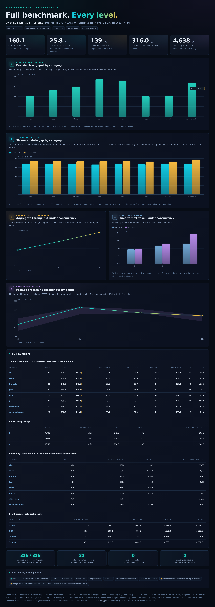
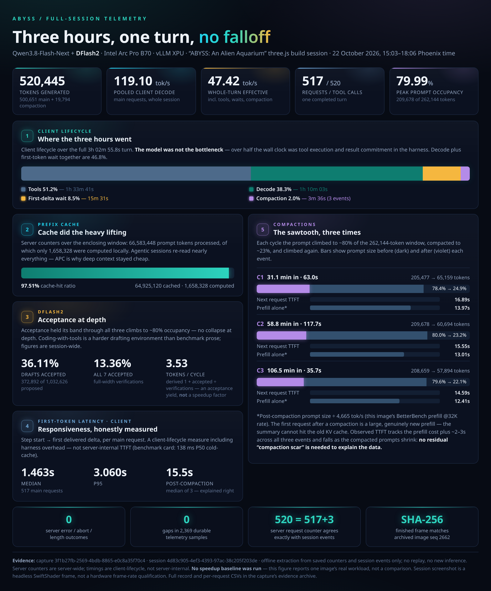
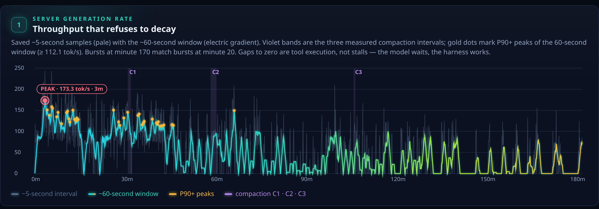
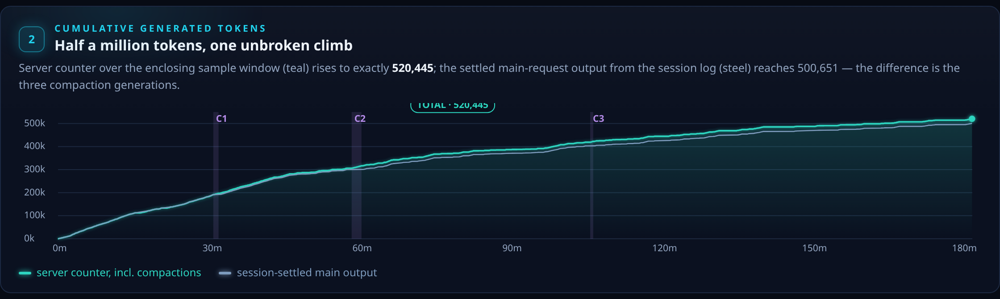
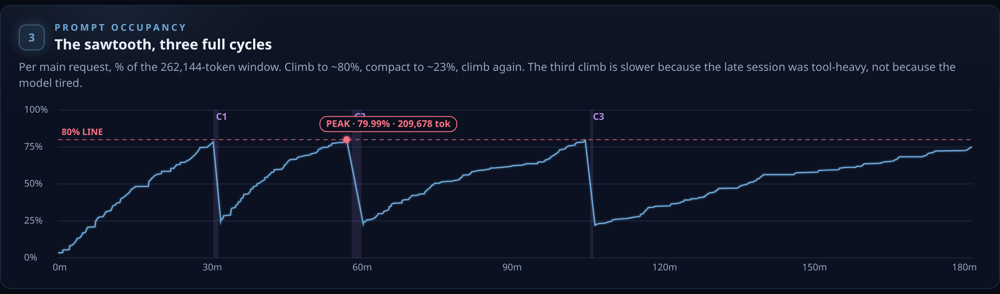
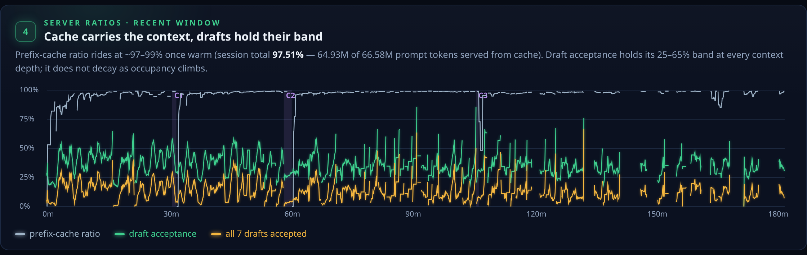
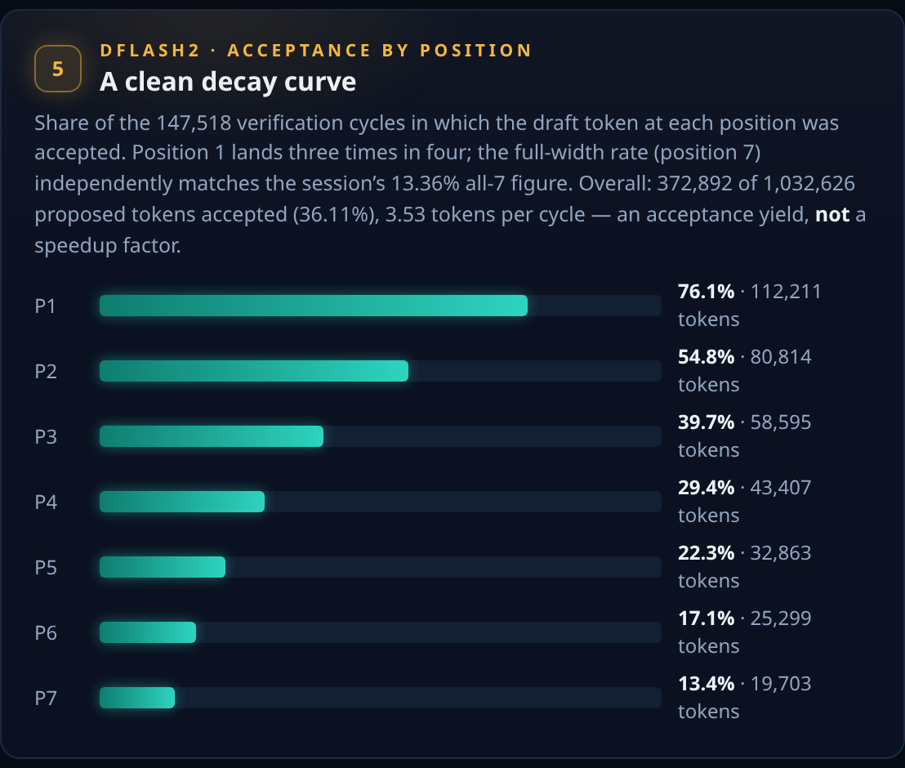
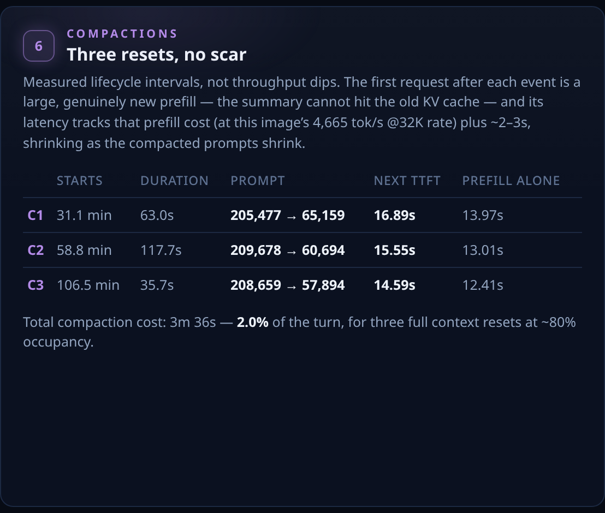
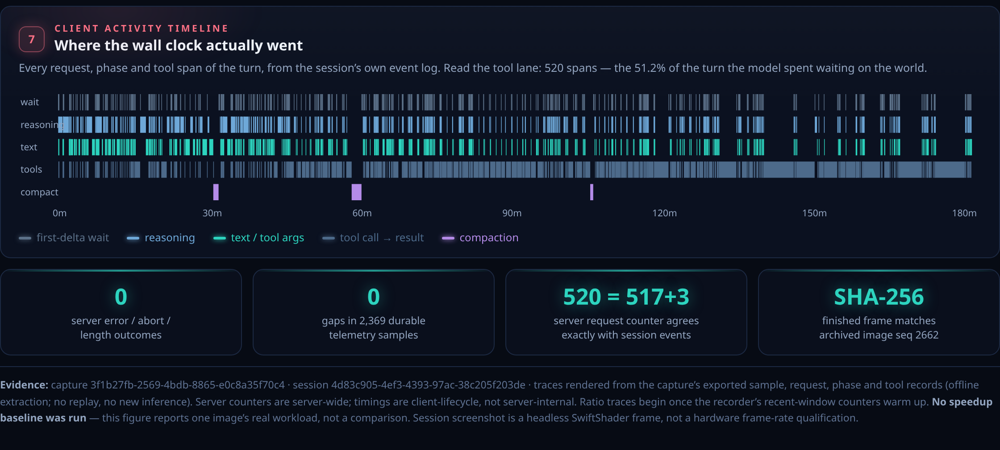

# Qwen3.8-Flash-Next + DFlash2 — 4× Intel Arc Pro B70

| | |
| --- | --- |
| Model | Qwen3.8-Flash-Next — Intel AutoRound W4A16 (4-bit weights, BF16 execution) |
| Draft | Qwen3.8-Flash-Next-DFlash2 — BF16, 7 proposals per cycle |
| Hardware | 4× Intel Arc Pro B70, 32 GB each |
| Parallelism | TP4, expert parallelism |
| Runtime | vLLM 0.32.0 XPU — `integrated-serving-v1` |
| Context | 262,144 tokens · 4 request slots |

The B70 implementation combines custom native kernels, guarded decode graphs, and verification/state handling with disk-backed BF16 PLE and a residency shim for GPU memory placement. The [runtime recipe](RUNTIME_RECIPE.md) records the exact configuration, model revisions and capacity limits.

## BetterBench performance

BetterBench v0.6.0 run using the accepted `integrated-serving-v1` runtime: **336/336 measured requests completed**, plus **32 warmups**. Weighted combined decode was **160.11 tok/s**, median time to first token (TTFT) **139.39 ms**, and stream-update p99 **25.82 ms**. The graphic rounds these headline values for display.

| Concurrent requests | Completed | Aggregate throughput | Median decode per request | Median TTFT |
| --- | --- | --- | --- | --- |
| 1 (C1) | 48/48 | 146.50 tok/s | 183.46 tok/s | 140.99 ms |
| 2 (C2) | 48/48 | 227.12 tok/s | 145.60 tok/s | 175.95 ms |
| 4 (C4) | 48/48 | 316.01 tok/s | 106.58 tok/s | 196.47 ms |

Aggregate throughput counts output across concurrent requests; it differs from the per-request rate and the weighted single-stream score. Stream-update gaps measure delivery of token batches, rather than individual token latency. This run used fresh prefix-cache salts with warm model/OS/PLE caches. The report records zero prefix-cache hits and zero server errors. Its small-sample tail estimates should be read with the qualifications printed in the report.

[Open the complete BetterBench PNG at original resolution](patches/assets/betterbench-integrated-serving-v1-full.png).
The [retained qualification reports](patches/archive/qualification/README.md)
and the runtime recipe preserve earlier measurements; the figures above refer
to this latest rerun. One run does not establish a universal gain.

## three.js build session

DeepSeek Harness three.js build session results: one completed turn spanning 3h 02m 55.8s and 520,445 generated tokens.

### Session overview

The report accounts for **520,445 generated tokens**: 500,651 from main requests
and 19,794 from compaction. It records **517 main requests**, **520 tool calls**
and **three compactions**. Pooled client decode was **119.10 tok/s**; the whole-turn
effective rate, including tools, waits and compaction, was **47.42 tok/s**.

These are session measurements with different counting windows from BetterBench.
Client first-delta timing includes harness overhead; server counters cover the
enclosing capture window. The telemetry graphics retain their contemporaneous
benchmark references (138 ms and 4,665 tok/s), while the BetterBench section above
uses the later rerun. No speedup baseline was run for the aquarium session.

### Generation through the session

### Context growth and prefix caching

### Draft acceptance and compaction details

### Client activity and evidence

[Open the complete, unchanged full-session trace report](patches/assets/aquarium-telemetry-full.png)
or [the unchanged overview](patches/assets/aquarium-telemetry-overview.png).
[Visual asset record](patches/assets/README.md)

## Installation and operation

The model pack provides a single DFlash2 runtime profile for B70 LLM Controller.

- **Hardware:** 4× Intel Arc Pro B70, 32 GB each; NVMe storage for disk-backed PLE.
- **Models:** Pinned Intel AutoRound W4A16 target and BF16 DFlash2 draft.
- **Runtime:** vLLM 0.32.0 XPU, TP4 with expert parallelism.
- **Context:** 262,144 total tokens per request.
- **Concurrency:** Four request slots sharing a 491,165-token KV cache. Four simultaneous full-context requests are not supported.
- **Features:** Automatic prefix caching, reasoning, tool calling, continuation and up to two images.

The [runtime recipe](RUNTIME_RECIPE.md) provides model revisions, dependencies, source reconstruction, configuration and launch instructions.

## Source access, credits and limitations

[Production source and build instructions](patches/production/README.md) · [Complete development patch archive](patches/INDEX.md) · [Source access](patches/licenses/SOURCE_ACCESS.md) · [Credits and notices](patches/licenses/NOTICE.md)

B70 LLM Controller is licensed under MIT. Model weights, vLLM, Intel software and other third-party components retain their respective licenses.

The runtime uses a text-only DFlash2 draft supplied with features from the multimodal target. Video input is disabled. Hardware requirements, resource limits and reproducibility details are documented in the [runtime recipe](RUNTIME_RECIPE.md).
